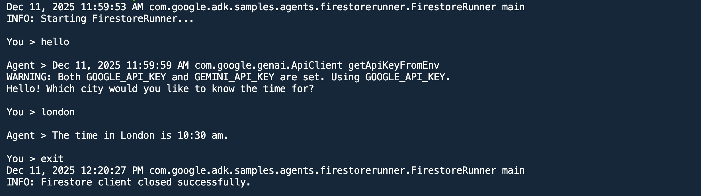

# Firestore Session Service (Java)

Demonstrates persistent multi-turn conversation using
[Google Cloud Firestore](https://cloud.google.com/firestore) as a session data
store with the [ADK for Java](https://github.com/google/adk-java).

A simple time agent converses with the user over the CLI. Each turn's session
state — the full conversation history — is written to Firestore, so the agent
maintains context across restarts and could be shared across multiple
application instances.

## How it works

| File | What it holds |
| --- | --- |
| `FirestoreRunner.java` | Entry point: initialises Firestore, creates a session, and runs the interactive CLI loop |

`FirestoreRunner` wires three ADK pieces together:

- **`FirestoreSessionService`** — reads and writes session state to Firestore
- **`FirestoreDatabaseRunner`** — runs the agent turn, persisting events via the session service
- **`LlmAgent`** — a single-agent that answers "what time is it in &lt;city&gt;?" using a mock `getCurrentTime` tool

## Prerequisites

- JDK 17 or later
- Maven 3.9 or later
- A Google Cloud project with the [Firestore API enabled](https://console.cloud.google.com/firestore) (Native mode)
- Either the Vertex AI API enabled, or a [Gemini API key](https://aistudio.google.com/apikey)
- [Google Cloud SDK](https://cloud.google.com/sdk/docs/install) (`gcloud`) installed and authenticated

## Configuration

Copy the example environment file and fill it in:

```bash
cp .env.example .env
```

Edit `.env` and set your project values. To use Vertex AI, authenticate with
Application Default Credentials:

```bash
gcloud auth application-default login
```

To use the Gemini API instead, set `GOOGLE_GENAI_USE_VERTEXAI=False` and
`GOOGLE_API_KEY`. The `MODEL_NAME` variable controls which model the agent
uses; it defaults to `gemini-3.5-flash` if unset.

## Running the agent

```bash
mvn compile exec:java -Dexec.mainClass="com.google.adk.samples.agents.firestorerunner.FirestoreRunner"
```

The agent starts an interactive CLI loop. Type a city name to ask for the
time, and `quit` or `exit` to stop:

```
You > What time is it in London?

Agent > The time in London is 10:30 am.

You > quit
```

Session state is written to Firestore after every turn, so you can stop and
restart the agent and the session history will be preserved.



## Testing

```bash
mvn test
```

Unit tests cover the `getCurrentTime` tool and the agent initialisation. They
do not call the model or Firestore, so no credentials are needed.
