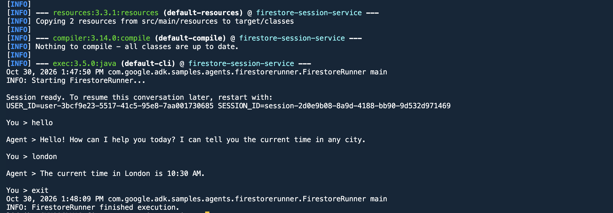

# Firestore Session Service (Java)

Demonstrates persistent multi-turn conversation using
[Google Cloud Firestore](https://cloud.google.com/firestore) as a session data
store with the [ADK for Java](https://github.com/google/adk-java).

A simple time agent converses with the user over the CLI. Each turn's session
state — the full conversation history — is written to Firestore, so the agent
maintains context across restarts and could be shared across multiple
application instances.

## How it works

| File | What it holds |
| --- | --- |
| `FirestoreRunner.java` | Entry point: initialises Firestore, creates a session, and runs the interactive CLI loop |

`FirestoreRunner` wires three ADK pieces together:

- **`FirestoreSessionService`** — reads and writes session state to Firestore
- **`FirestoreDatabaseRunner`** — runs the agent turn, persisting events via the session service
- **`LlmAgent`** — a single-agent that answers "what time is it in &lt;city&gt;?" using a mock `getCurrentTime` tool

## Prerequisites

- JDK 17 or later
- Maven 3.9 or later
- A Google Cloud project with the [Firestore API enabled](https://console.cloud.google.com/firestore) (Native mode)
- Either the Vertex AI API enabled, or a [Gemini API key](https://aistudio.google.com/apikey)
- [Google Cloud SDK](https://cloud.google.com/sdk/docs/install) (`gcloud`) installed and authenticated

## Configuration

Copy the example environment file and export its values into your shell session (Java reads configuration directly from environment variables):

```bash
cp .env.example .env
export $(grep -v '^#' .env | xargs)
```

Alternatively, you can set the environment variables directly in your terminal.

To use Vertex AI, authenticate with Application Default Credentials:

```bash
gcloud auth application-default login
```

To use the Gemini API instead, set `GOOGLE_GENAI_USE_VERTEXAI=False` and
`GOOGLE_API_KEY`. The `MODEL_NAME` variable controls which model the agent
uses; it defaults to `gemini-3.7-flash` if unset.

## Running the agent

```bash
mvn compile exec:java -Dexec.mainClass="com.google.adk.samples.agents.firestorerunner.FirestoreRunner"
```

The agent starts an interactive CLI loop. Type a city name to ask for the
time, and `quit` or `exit` to stop:

```
You > What time is it in London?

Agent > The time in London is 10:30 am.

You > quit
```

Session state is written to Firestore after every turn. On startup, the agent
prints a `USER_ID`/`SESSION_ID` pair; set these as environment variables on
your next run to resume the same conversation with its history intact:

```bash
USER_ID=user-... SESSION_ID=session-... mvn compile exec:java -Dexec.mainClass="com.google.adk.samples.agents.firestorerunner.FirestoreRunner"
```

Without them, each run starts a brand-new session.



## Running with Docker

You can also build and run the agent as a container image. Because `FirestoreRunner` is an interactive CLI agent running over standard input, allocate a pseudo-TTY and keep stdin open with `-it`.

When running locally with Application Default Credentials (ADC), mount your host's credentials file into the container and set `GOOGLE_APPLICATION_CREDENTIALS` (when deployed to Google Cloud services like Cloud Run, credentials are provided automatically by the attached service account):

```bash
docker build -t firestore-session-service .
docker run -it \
  --env-file .env \
  -v ~/.config/gcloud/application_default_credentials.json:/app/credentials.json:ro \
  -e GOOGLE_APPLICATION_CREDENTIALS=/app/credentials.json \
  firestore-session-service
```

To resume an existing conversation inside the container:

```bash
docker run -it \
  --env-file .env \
  -v ~/.config/gcloud/application_default_credentials.json:/app/credentials.json:ro \
  -e GOOGLE_APPLICATION_CREDENTIALS=/app/credentials.json \
  -e USER_ID="user-..." \
  -e SESSION_ID="session-..." \
  firestore-session-service
```

## Testing

```bash
mvn test
```

Unit tests cover the `getCurrentTime` tool and the agent initialisation. They
do not call the model or Firestore, so no credentials are needed.
