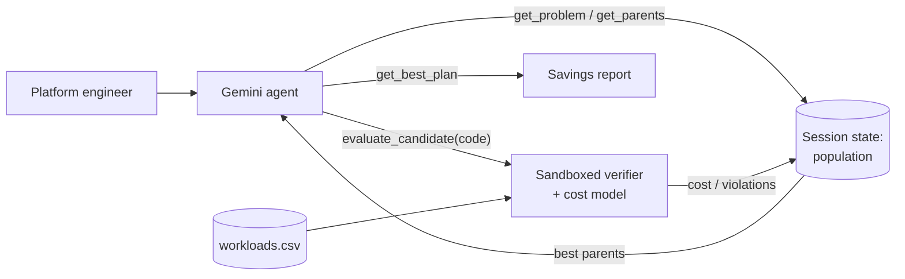

# alphaevolve-optimizer

**Cut Kubernetes node cost with an AlphaEvolve-style coding agent.**

Platform teams pay for nodes, not pods. Picking which node types to run and
how to pack pods onto them is a hard combinatorial problem, and most clusters
settle for a single default node pool. This recipe points an ADK agent at the
real decision: it **evolves a workload placement program** that fits every
pod's CPU and memory requests onto the cheapest mix of nodes.

The agent never grades its own work. It runs a **propose → verify → select**
loop:

1. **Propose** – Gemini writes a new placement program, building on the
   cheapest verified programs so far and the feedback they received.
2. **Verify** – `evaluate_candidate` runs the program in a separate,
   resource-limited Python process against your workloads, checks every
   capacity constraint, and prices the result. Invalid plans are rejected
   with a precise reason.
3. **Select** – the best verified programs stay in ADK session state as
   parents for the next round, until the evaluation budget is spent or the
   cost reaches a proven lower bound.

The output is a report a platform team can act on: monthly cost before and
after, the recommended node mix per cluster, and the program that produced
it — which you can rerun whenever workloads change.



## Real-world scenario

The bundled sample (`app/data/workloads.csv`) models three production
clusters with 263 pods: an e-commerce stack (storefront, checkout, search,
recommendations), a data platform (Kafka, Spark, Trino, Airflow) and an ML
serving tier (embedding and ranking servers). They have very different
memory-to-CPU ratios, which is exactly where a single node pool wastes money.

| | Monthly cost |
| --- | --- |
| Baseline: one `std-8` node pool, first-fit | $7,238.68 |
| Proven lower bound (no plan can be cheaper) | $4,935.31 |

### Example run

One run with `gemini-3.7-flash` and the default budget of 10 evaluations
(every cost below was computed by the verifier):

| Step | Idea proposed by the agent | Verified monthly cost |
| --- | --- | --- |
| baseline | One `std-8` node pool, first-fit | $7,238.68 |
| 1 | Best-fit across node types, right-size the last nodes, evacuation search | $6,838.64 |
| 3 | Send low memory/CPU pods to `highcpu-16`, high-ratio pods to `highmem-8` | $6,834.26 |
| 4 | Node-mix templates with min-conflicts overflow repair | $6,643.00 |
| 8 | Steepest-descent overflow repair plus consolidation | **$6,634.24** |

Result: **$604.44/month saved (8.4%)** across the three clusters, by moving
from 37 `std-8` nodes to a per-cluster mix of `highcpu-16`, `std-16`, `std-8`
and `std-4` nodes. Two proposals were rejected by the verifier (one exceeded
the code-size limit, one overfilled a node's pod limit). Results vary between
runs because proposals come from a model.

The node menu and prices in [`app/problem.py`](app/problem.py) are
**illustrative**; replace them with your own node types and negotiated rates.

### Use your own workloads

Point `WORKLOADS_CSV` at a CSV of your pods' resource requests:

```csv
cluster,workload,replicas,cpu_millicores,memory_mib
checkout-prod,payments-api,6,1000,1024
```

You can build it from `kubectl get deployments -A -o json` (container
`resources.requests` times `spec.replicas`) or from your cost-allocation
export. Each `cluster` value becomes one benchmark instance.

## What you will learn

- Grounding an LLM in a **deterministic verifier** so every claimed saving is
  measured, not asserted.
- Keeping an evolving **population in ADK session state** with `ToolContext`
  and enforcing an evaluation budget inside tools.
- Running untrusted, model-written code with **process isolation**, timeouts
  and resource limits, and scoring it outside the child process.

## Requirements

Before you begin, ensure you have:
- **uv**: Python package manager - [Install](https://docs.astral.sh/uv/getting-started/installation/)
- Access to Gemini through Vertex AI or a Google AI Studio API key.

## Setup

> **Note**: All commands below must be run from the recipe root directory (`contrib/python/alphaevolve-optimizer/`).

1. Install required packages:
   ```bash
   uv sync
   ```

2. Set up environment variables. Copy `.env.example` to `.env` and configure
   either Vertex AI (`GOOGLE_CLOUD_PROJECT`, `GOOGLE_GENAI_USE_VERTEXAI=True`)
   or `GEMINI_API_KEY`:
   ```bash
   cp .env.example .env
   ```

   | Variable | Default | Purpose |
   | --- | --- | --- |
   | `MODEL_NAME` | `gemini-3.7-flash` | Model that proposes programs |
   | `WORKLOADS_CSV` | bundled sample | Your pods' resource requests |
   | `MAX_EVALUATIONS` | `10` | Verifier calls allowed per session |
   | `POPULATION_SIZE` | `4` | Best programs kept as parents |
   | `CANDIDATE_TIMEOUT_SECONDS` | `10` | Wall-clock and CPU limit per evaluation |

## Run

Start the agent in the terminal and ask it to cut cost:

```bash
uv run adk run app
# > Find the cheapest node plan for my clusters.
```

Or start the local web server and open the ADK dev UI:

```bash
uv run uvicorn app.fast_api_app:app --reload
```

## Deploy and use it where your team works

The recipe ships a `Dockerfile` and serves the standard ADK FastAPI app, so
it runs on Cloud Run:

```bash
gcloud run deploy alphaevolve-optimizer --source . --region us-central1 \
  --set-env-vars MODEL_NAME=gemini-3.7-flash,GOOGLE_GENAI_USE_VERTEXAI=True
```

To bring it to your team, make the agent available in your Gemini Enterprise
app (the recipe includes an Agent Engine adapter in `app/app_utils/`) and
expose it in Google Chat by following
[Build a Google Chat app with a Gemini Enterprise AI agent](https://developers.google.com/workspace/chat/quickstart-ge-agent).
Engineers can then ask for a fresh cost plan from a Chat space whenever
workloads change.

## Use it for other problems

Everything problem-specific lives in [`app/problem.py`](app/problem.py):
`PROBLEM_STATEMENT`, `ENTRY_POINT`, `INSTANCES`, `BASELINE_PROGRAM`,
`lower_bound()` and `score_outputs()`. Replace them to evolve another
program with a measurable objective, such as a job scheduler, a routing
heuristic or a cache eviction policy. The loop, sandbox and selection logic
stay the same.

## Safety

The verifier isolates candidates in a separate interpreter (`python -I -B`)
with an empty environment, a timeout, and CPU, memory and file-write limits.
This is **process isolation, not a security sandbox**. Run the recipe in its
container and add a stronger sandbox (for example gVisor) before exposing it
to untrusted users. The agent only recommends a plan; it never changes your
clusters.

## Running Tests

The unit tests cover the cost model, the verifier, the selection logic and
the tools, and do not call a model:

```bash
uv run pytest
```

Integration tests call Gemini and need credentials:

```bash
uv run pytest tests/integration
```

## Commands

| Command | Description |
| ------- | ----------- |
| `uv run adk run app` | Run the agent in interactive CLI mode |
| `uv run uvicorn app.fast_api_app:app --reload` | Start the local FastAPI development server |
| `uv run pytest` | Run the unit and runnability tests |
