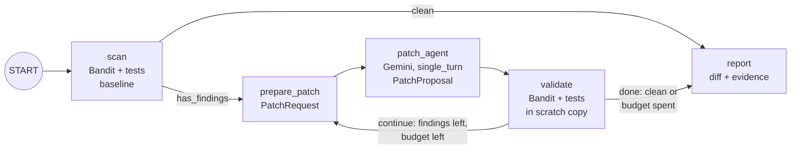

# code-security-fixer

**Fix real security vulnerabilities with an agent whose every patch must pass
a deterministic validator.**

Security scanners and advisories are good at producing findings and bad at
closing them. AppSec and platform teams end up with a backlog that every
service team has to triage and patch by hand, and a first patch is often
incomplete. This recipe points an ADK agent at that backlog: Gemini proposes
fixes, and a **deterministic validator** (Bandit plus the project's own
functional and exploit tests) decides which ones are kept. The output is a
unified diff with evidence for human review. Nothing is committed or pushed.

The bundled target is real: Django's `archive.extract()` at the commit before
**CVE-2021-3281**, whose first fix turned out to be incomplete and needed a
second advisory, **CVE-2025-59682**, four years later. The README shows the
agent's fix next to both historical patches.

## How it works

The agent never grades its own work. It is an **ADK 2.0 graph workflow**
(`google.adk.Workflow`) in which only one node calls a model:

1. **`scan`** (function node) copies the target to a throwaway working copy
   and records the baseline: [Bandit](https://bandit.readthedocs.io/) plus
   the project's own tests. Failing exploit tests are findings too, so
   issues a static analyzer cannot see (such as this path traversal) are
   covered. Routes to `prepare_patch` if anything is open, otherwise
   straight to `report`.
2. **`prepare_patch`** (function node) packs the open findings, the source
   files, the failing tests and the reason the last proposal was rejected
   into a typed `PatchRequest`.
3. **`patch_agent`** (`Agent`, `mode="single_turn"`) reads the
   `PatchRequest` and returns one structured `PatchProposal`: file, complete
   new content and rationale. It has no tools and no file system access.
4. **`validate`** (function node) applies the proposal to a scratch copy and
   re-runs Bandit and every test in a resource-limited subprocess. The patch
   is kept only if it **resolves at least one finding, introduces no new
   Bandit finding and breaks no passing test**. Edits to tests and
   `# nosec` suppressions are refused. Routes back to `prepare_patch` (with
   the rejection reason as feedback) while findings remain and the
   `MAX_PATCH_ATTEMPTS` budget lasts, otherwise to `report`.
5. **`report`** (function node) produces the unified diff and the evidence.



Each user message starts a fresh run, so the same agent works from the ADK
dev UI, `adk run`, A2A clients, Gemini Enterprise and the Gemini agent.
There is no `RequestInput` approval step: the workflow never applies
anything, so the human approval happens where it belongs, in code review of
the diff. A pause-and-resume step would also leave A2A chats waiting on an
input most clients cannot send.

## Real-world anchor: Django CVE-2021-3281 and CVE-2025-59682

`django.utils.archive.extract()` unpacks `.tar`/`.zip` templates for
`startapp --template` and `startproject --template`. The bundled target
([`app/django_archive/`](app/django_archive/)) is that module at Django
commit
[`6822aa5c`](https://github.com/django/django/tree/6822aa5c6c3fbec7c5393a05e990865ba59fe167),
the parent of the first fix, byte-identical to upstream below a short
vendoring header (BSD-3-Clause, licence and provenance in
[`app/django_archive/README.md`](app/django_archive/README.md)).

| | CVE-2021-3281 | CVE-2025-59682 |
| --- | --- | --- |
| Advisory | [GHSA-fvgf-6h6h-3322](https://github.com/advisories/GHSA-fvgf-6h6h-3322) | [GHSA-q95w-c7qg-hrff](https://github.com/advisories/GHSA-q95w-c7qg-hrff) |
| Bug | Members with `..` segments or absolute paths are written outside the target directory | The 2021 fix checked `filename.startswith(target_path)`, so `<target>abc/evil.txt` still escaped |
| Historical fix | [`05413afa`](https://github.com/django/django/commit/05413afa8c18cdb978fcdf470e09f7a12b234a23) (Feb 2021) | [`924a0c09`](https://github.com/django/django/commit/924a0c092e65fa2d0953fd1855d2dc8786d94de2) (Oct 2025) |

The target ships Django's functional tests for `extract()` (adapted to build
the fixture archives in code) and three exploit tests that reproduce the
archives from Django's own regression tests for both CVEs:

| Baseline | |
| --- | --- |
| Bandit findings | 0 (Bandit has no rule for this traversal) |
| Functional tests | 3/3 passing |
| Exploit tests | 0/3 passing: `cve_2021_3281_dot_segments`, `cve_2021_3281_absolute_path`, `cve_2025_59682_sibling_prefix` |

The unit tests replay history through the validator with Django's exact
patches ([`tests/unit/reference_fixes.py`](tests/unit/reference_fixes.py)):
the 2021 patch is **accepted as a partial fix** (two exploit tests fixed,
CVE-2025-59682 still open), and the 2025 patch on top closes the last one.
That is the point of the validator: an incomplete patch cannot be reported
as complete.

### Example run

One live run of the workflow against the bundled target with
`MODEL_NAME=gemini-3.7-flash` and the default budget of 8 patch attempts:

| Metric | Result |
| --- | --- |
| Exploit tests passing | 0/3 → **3/3** (both CVEs), functional tests still 3/3 |
| Bandit findings | 0 → 0 (no new findings) |
| Patch attempts | **1 of 8**, accepted by the validator |
| Model calls | 1 (`patch_agent`) |
| Wall-clock time | 224.1 s (almost all of it the single model call) |
| Tokens | 4.0k prompt, 2.5k output |

The agent's fix next to Django's (abridged; tar branch shown, the zip branch
is the same):

#### Agent (one attempt): both CVEs closed
```diff
+from django.core.exceptions import SuspiciousOperation
 ...
     def extract(self, to_path):
+        target_path = os.path.realpath(to_path)
         members = self._archive.getmembers()
 ...
             filename = os.path.join(to_path, name)
+            resolved_path = os.path.realpath(filename)
+            try:
+                if os.path.commonpath([target_path, resolved_path]) != target_path:
+                    raise SuspiciousOperation(
+                        "Extraction path '%s' is outside target directory '%s'"
+                        % (filename, target_path)
+                    )
+            except ValueError:
+                raise SuspiciousOperation(...)
```

#### Django, Feb 2021 (05413afa): fixes CVE-2021-3281 only
```diff
+from django.core.exceptions import SuspiciousOperation
 ...
+    def target_filename(self, to_path, name):
+        target_path = os.path.abspath(to_path)
+        filename = os.path.abspath(os.path.join(target_path, name))
+        if not filename.startswith(target_path):
+            raise SuspiciousOperation("Archive contains invalid path: '%s'" % name)
+        return filename
 ...
-            filename = os.path.join(to_path, name)
+            filename = self.target_filename(to_path, name)
```

#### Django, Oct 2025 (924a0c09): fixes CVE-2025-59682
```diff
-        if not filename.startswith(target_path):
+        try:
+            if os.path.commonpath([target_path, filename]) != target_path:
+                raise SuspiciousOperation("Archive contains invalid path: '%s'" % name)
+        except ValueError:
+            # Different drives on Windows raises ValueError.
             raise SuspiciousOperation("Archive contains invalid path: '%s'" % name)
```

The agent landed on the same check Django ended up with in 2025
(`os.path.commonpath`, including the Windows `ValueError` case) in one
attempt, and used `realpath`, which also resolves symlinks. A reviewer would
still ask for changes: the check is duplicated in both archive classes
instead of a helper like Django's `target_filename`, and it does not skip
empty names in zip files as Django's patch does. That is why the output is a
diff for review, not a commit. Numbers and the exact patch vary between runs.

### Use your own repository

Point `TARGET_DIR` at a Python project. It is copied to a temporary working
directory (without `.git`, virtualenvs or `.env`) and never modified:

```bash
TARGET_DIR=/path/to/payments-service \
TEST_COMMAND="python -m pytest -rA -q" \
uv run adk run app
```

- With no `TEST_COMMAND`, stdlib `unittest` tests under `tests/` are
  discovered and reported per test. For pytest, pass `-rA` so per-test
  results are visible; otherwise only the exit code is used.
- The tests run with this recipe's interpreter, so your project's test
  dependencies must be installed there (for example `uv add --dev pytest`).
- Add exploit tests for the findings you care about. They are what turns
  "Bandit is quiet" into "the attack no longer works".
- Files under `tests/`, `test_*.py`, `*_test.py` and `conftest.py` are
  evidence: the agent can read them but cannot change them.

## What you will learn

- Gating every model-written change with a **deterministic validator** that
  compares scanner and test results before and after, so the model cannot
  talk its way past a failing test, and a partial fix stays visibly partial.
- Building an **ADK 2.0 graph workflow**: function nodes for deterministic
  steps, a `single_turn` `Agent` with Pydantic `input_schema` /
  `output_schema` for the one creative step, and conditional routing
  (`Event(route=...)`) for a bounded retry loop.
- Keeping the working copy, baseline, accepted patches and attempt budget in
  ADK session state (`ctx.state`), reproducible on any server instance.
- Serving the same workflow over **A2A** (JSON-RPC and HTTP+JSON), so it can
  be registered in Gemini Enterprise and called from the Gemini agent.
- Running untrusted project code with **process isolation**, timeouts,
  resource limits and an environment stripped of credentials.

## Requirements

Before you begin, ensure you have:
- **uv**: Python package manager - [Install](https://docs.astral.sh/uv/getting-started/installation/)
- Access to Gemini through Vertex AI or a Google AI Studio API key.

## Setup

> **Note**: All commands below must be run from the recipe root directory (`contrib/python/code-security-fixer/`).

1. Install required packages (this includes Bandit):
   ```bash
   uv sync
   ```

2. Set up environment variables. Copy `.env.example` to `.env` and configure
   either Vertex AI (`GOOGLE_CLOUD_PROJECT`, `GOOGLE_GENAI_USE_VERTEXAI=True`)
   or `GEMINI_API_KEY`:
   ```bash
   cp .env.example .env
   ```

   | Variable | Default | Purpose |
   | --- | --- | --- |
   | `MODEL_NAME` | `gemini-3.7-flash` | Model that writes the patches |
   | `TARGET_DIR` | bundled Django target | Repository to fix (copied, never modified) |
   | `TEST_COMMAND` | `unittest` discovery | Test command (no shell) |
   | `BANDIT_SKIPS` | `B101,B404,B603,B607` | Bandit checks that flag usage, not vulnerabilities |
   | `MAX_PATCH_ATTEMPTS` | `8` | Validator calls allowed per session |
   | `VALIDATION_TIMEOUT_SECONDS` | `120` | Wall-clock and CPU limit per scan or test run |

## Run

Start the agent in the terminal and ask it to fix the target:

```bash
uv run adk run app
# > Fix the security findings in the bundled Django archive code and give me a reviewable patch.
```

Or start the local web server and open the ADK dev UI:

```bash
uv run uvicorn app.fast_api_app:app --reload
```

The final report includes the diff, and the `report` node also writes it to
a `security-fix.patch` file next to the working copy. Apply it to a branch of
your repository with `git apply security-fix.patch` and open a normal code
review. Working copies live under the system temp directory
(`code-security-work-*`) and are left in place so you can inspect them;
delete them when you are done.

## Deploy

The recipe ships a `Dockerfile` (non-root user, Bandit installed) that serves
the standard ADK FastAPI app plus these integration surfaces from
[`app/fast_api_app.py`](app/fast_api_app.py):

- **A2A JSON-RPC** at `/a2a/app` (A2A 1.0 and 0.3), with the agent card at
  `/a2a/app/.well-known/agent-card.json`. The card has the 0.3 shape
  (top-level `url`, `protocolVersion: "0.3"`) that Gemini Enterprise
  registration validates.
- **A2A HTTP+JSON** under the same base: `GET /a2a/app/v1/card`,
  `POST /a2a/app/v1/message:send` and `POST /a2a/app/v1/message:stream`
  (plus the 1.0 REST routes). The card advertises `HTTP+JSON` interfaces for
  1.0 and 0.3; in the 0.3 shape `preferredTransport` is `HTTP+JSON` and
  JSON-RPC is listed in `additionalInterfaces`, both at the same URL.
- **Agent Engine** (`app/app_utils/reasoning_engine_adapter.py`):
  `POST /api/reasoning_engine` and `/api/stream_reasoning_engine`, the
  routes Agent Engine forwards `:query` and `:streamQuery` to.

Deploy it, for example to Cloud Run:

```bash
gcloud run deploy code-security-fixer --source . --region us-central1 \
  --no-allow-unauthenticated \
  --set-env-vars MODEL_NAME=gemini-3.7-flash,GOOGLE_GENAI_USE_VERTEXAI=True,APP_URL=https://YOUR-SERVICE-URL
```

Set `APP_URL` to the service URL so the agent card points at it, then check
`https://YOUR-SERVICE-URL/a2a/app/.well-known/agent-card.json`. To fix your
own code in Cloud Run, bake the repository into the image (or mount it) and
set `TARGET_DIR`. Keep the service private: it executes the target's tests.

### Use it in the Gemini agent and Gemini Enterprise

1. Register the deployed service as an A2A agent with its agent card,
   following
   [Register and manage A2A agents](https://docs.cloud.google.com/gemini/enterprise/docs/register-and-manage-an-a2a-agent)
   and
   [Agent Registry](https://docs.cloud.google.com/gemini-enterprise-agent-platform/govern/agent-registry).
2. The Gemini agent calls registered A2A agents over the HTTP+JSON binding
   ([Invoke an A2A agent](https://docs.cloud.google.com/gemini/enterprise/docs/invoke-agent-a2a)):
   `GET /v1/card`, then `POST /v1/message:send` with a `ROLE_USER` message.
   This app serves those routes. A request without a `configuration` waits
   for the finished task, so the answer is the full report and diff.
3. Optionally expose it in Google Chat with
   [Build a Google Chat app with a Gemini Enterprise AI agent](https://developers.google.com/workspace/chat/quickstart-ge-agent).

What was verified locally (no GCP project, Agent Registry or Gemini
Enterprise tenant was available):

- The agent card has the 0.3 fields above and lists JSON-RPC and HTTP+JSON
  interfaces for 1.0 and 0.3.
- `GET /a2a/app/v1/card` returns the card, and `POST /a2a/app/v1/message:send`
  with `role: ROLE_USER`, `content[].text` and a unique `messageId` runs the
  whole workflow and returns `TASK_STATE_COMPLETED` with the report and diff.
- A JSON-RPC `message/send` with `A2A-Version: 0.3` returns the same report
  as a completed task.
- The Agent Engine adapter creates sessions. A full run through it needs
  Vertex AI credentials, because Agent Engine's runtime switches the model
  client to Vertex AI.

[`tests/integration/test_a2a.py`](tests/integration/test_a2a.py) repeats all
of these checks.

## Safety

- **Process isolation, not a sandbox.** Bandit and the target's tests run in
  a separate interpreter with a minimal environment (no API keys or cloud
  credentials), a timeout, and CPU, memory and file-size limits, inside a
  disposable copy. The tests are still arbitrary code with network and file
  system access. Run the recipe in its container and add a stronger sandbox
  (for example gVisor) before pointing it at code you do not trust.
- **The target is never modified.** All edits happen in a temporary working
  copy; validation happens in a second, scratch copy.
- **The agent never commits or pushes.** It has no git or network tools. Its
  only output is a diff and a report.
- **Human review is required.** Passing Bandit and the tests is necessary,
  not sufficient: Django's own 2021 patch passed its tests and was still
  incomplete. Review every patch like any other change before merging.
- **The bundled target is vulnerable on purpose.** Never import
  `app/django_archive/` outside this recipe.

## Running Tests

The unit tests cover the scanner and test harness, the validator (accepting
Django's 2025 patch, accepting the 2021 patch as partial, rejecting a broken
and an ineffective patch, prechecks), each deterministic workflow step, the
attempt budget, `TARGET_DIR` handling and report generation. They also run
the real ADK 2.0 graph end to end with the Gemini node swapped for a scripted
function node that replays Django's history (ineffective patch → 2021 patch
→ 2025 patch), so routing is tested. They run Bandit and the target's tests
for real and do not call a model:

```bash
uv run pytest
```

Integration tests call Gemini and need credentials. `test_a2a.py` starts the
server and checks the agent card, JSON-RPC `message/send`, the HTTP+JSON
`/v1/card` and `/v1/message:send` routes, and the Agent Engine adapter:

```bash
uv run pytest tests/integration
```

## Commands

| Command | Description |
| ------- | ----------- |
| `uv run adk run app` | Run the agent in interactive CLI mode |
| `uv run uvicorn app.fast_api_app:app --reload` | Start the local FastAPI development server |
| `uv run pytest` | Run the unit and runnability tests |
