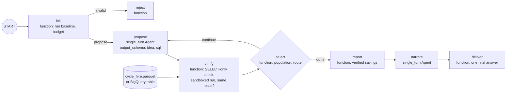

# evolutionary-llm-optimizer

**Cut the cost of analytics SQL with an LLM that proposes and a verifier that proves.**

Data teams pay for the bytes their queries scan. On BigQuery on-demand
pricing that is literally the bill, and the same queries run every hour in
dashboards and scheduled jobs. Many of them carry expensive habits: a
`SELECT DISTINCT *` "to be safe", a date filter wrapped in a formatting
function, one CTE per month that rescans the table.

This recipe points an ADK 2.0 workflow at that problem. Given an expensive
query, it **evolves rewrites that return exactly the same result while
scanning fewer bytes**. The model never grades its own work. A deterministic
verifier runs every rewrite, proves the result matches the baseline, and
meters the bytes scanned:

1. **Propose** – a single-turn Gemini agent writes one rewrite, building on
   the cheapest verified rewrites so far and the verifier's feedback.
2. **Verify** – a function node checks the rewrite is one read-only `SELECT`,
   runs it in a sandboxed process, compares the result with the baseline's
   and records the bytes it scanned.
3. **Select** – a function node keeps the cheapest verified rewrites in ADK
   session state as parents and routes back to *propose* until the
   evaluation budget is spent.

The output is a report a data team can act on: bytes scanned before and
after, the reduction, every rewrite tried with its verified cost, and the
rewritten SQL.

## Architecture



| Node | Type | What it does |
| --- | --- | --- |
| `init` | function | Picks the baseline (a bundled query, or one you paste in a fenced `sql` block), runs it, stores the expected result, seeds the population and sets the budget in `ctx.state`. Routes to `reject` if the baseline itself cannot run. |
| `propose` | `Agent(mode="single_turn")` | Gets a `ProposalBrief` (dialect, engine notes, schema, question, baseline SQL and bytes, expected result preview, parents with SQL, every rewrite tried, last feedback) and returns a `Candidate` (`idea`, `sql`). Sees only this brief, not the chat history. |
| `verify` | function | Rejects duplicates, non-`SELECT` statements and oversized SQL, runs the rewrite on the query engine and compares its result with the baseline's. No model involved. |
| `select` | function | Updates the population (fewest bytes first, runtime breaks ties) and returns `Event(route="continue")` or `Event(route="done")`. The loop is bounded by `MAX_EVALUATIONS`. |
| `report` | function | Re-runs the baseline and the best rewrite, re-checks the result, and renders the Markdown report from verifier numbers only. |
| `narrate` | `Agent(mode="single_turn")` | Adds a short summary and is told to quote only numbers from the report. |
| `deliver` | function | Sends the report and the summary as one final message, which is what A2A clients such as the Gemini agent show as the answer. |
| `reject` | function | Explains why a pasted query could not run. |

The workflow is the `root_agent`, wrapped in `App(root_agent=..., name="app")`,
so `adk run app`, `adk web`, the FastAPI server, the A2A endpoints and the
Agent Engine adapter all serve the same graph. Every message starts a fresh
run.

There is no human-approval (`RequestInput`) step: the agent only proposes a
rewrite and never changes a production query, and a pause in the middle of
the loop would leave chat users with a half-finished turn. Review the
rewrite before you replace the production query.

## Real-world scenario

The default run needs no credentials and uses **real public data that is
also in BigQuery**: London Santander Cycles journeys published by Transport
for London, the same records as
`bigquery-public-data.london_bicycles.cycle_hire`. The bundled sample
(`app/data/cycle_hire.parquet`, 1.27 MB) holds 1 in 40 journeys started
between March and May 2016: 60,672 rows with the table's core columns.
Provenance and licence are in [`app/data/README.md`](app/data/README.md).
Powered by TfL Open Data.

Three baseline queries model what a mobility analytics team runs every day,
each with a common and costly anti-pattern:

| Query id | Business question | Anti-pattern | Baseline bytes scanned |
| --- | --- | --- | --- |
| `commute_flows` (default) | Busiest station-to-station routes on weekday mornings | needless `SELECT DISTINCT *` dedup in a CTE | 1.34 MB |
| `station_demand` | 10 busiest start stations in April 2016 | date filter wrapped in a formatting function, over `SELECT *` | 234.63 KB |
| `monthly_trend` | Hires per station for March, April and May | one CTE per month plus a `DISTINCT` driver: four scans | 432.85 KB |

Ask for one by name ("optimize the monthly trend query"), or paste your own
query against `cycle_hire` in a fenced `sql` block.

### How cost is measured

- **DuckDB (default).** Each query runs in a fresh, single-threaded DuckDB
  process that reads the Parquet file through a metering filesystem; the
  score is the number of bytes actually read from the file. Like BigQuery,
  this charges for every column a query references and every time it scans
  the table, and like a partitioned or clustered BigQuery table it skips
  data when a filter compares the raw `start_date` column (the file is
  sorted by `start_date` in row groups of 4,096 rows). The numbers are
  reproducible run to run.
- **BigQuery (`QUERY_ENGINE=bigquery`).** The score is the dry-run
  `total_bytes_processed`, which is what
  [on-demand pricing](https://cloud.google.com/bigquery/pricing) bills. Each
  rewrite then runs once with `maximum_bytes_billed` set to
  `BIGQUERY_MAX_BYTES_BILLED`, so its result can be compared with the
  baseline's. The bundled BigQuery baselines restrict to the same spring 2016
  period. Note that the public table is not partitioned, so in BigQuery only
  column and scan reductions lower the bytes; date filters do not.

A rewrite counts only if it returns the same columns, values and row count
as the baseline, in the same order when the baseline has a top-level
`ORDER BY` (floats are compared to 9 significant digits). Equality is proven
on the data the run used: review a rewrite that relies on a property of
that data (for example, that a station's name identifies it as well as its
id does) before it replaces the production query.

### Example run

One run of the workflow on the default `commute_flows` query with
`gemini-3.7-flash` and the default budget of 8 evaluations, in 9 minutes 31
seconds (every number below was measured by the verifier, and every rewrite
returned the baseline's 15 rows):

| Candidate | Idea proposed by the `propose` node | Bytes scanned |
| --- | --- | --- |
| baseline | `SELECT DISTINCT *` CTE over every column | 1.34 MB |
| 1 | Drop the redundant `SELECT DISTINCT *` CTE so unused columns (`rental_id`, `bike_id`, `end_date`) are not read | 936.51 KB |
| 2 | Exclude round trips by comparing station names instead of ids, so the two id columns are not read | 821.29 KB |
| 3–8 | Reorder predicates, group by position, defer the rounding until after `LIMIT` | 821.29 KB (no further gain) |

Result: **521.52 KB fewer bytes scanned (38.8%)**, and runtime fell from
22.5 ms to 14.0 ms (the best rewrite is candidate 6: same bytes as 2, faster).
Rewrite 2 is the kind of change to review before production: on this data a
station's name and id identify it equally well, which the verifier proved,
but that is a property of the data rather than of the schema. The other two
bundled queries behave the same way; in a shorter 4-evaluation run over A2A,
`monthly_trend` went from 432.85 KB to 252.21 KB (41.7%) by collapsing four
scans into one with conditional aggregation. Results vary between runs
because proposals come from a model.

## What you will learn

- Building an **ADK 2.0 graph workflow** (`google.adk.Workflow`) that mixes
  deterministic function nodes with single-turn `Agent` nodes.
- Bounding an LLM loop with **conditional routing**
  (`Event(route=...)` and routing-map edges) instead of trusting the model to
  stop, plus an early `invalid` route for bad input.
- Passing structured data between nodes with Pydantic **`input_schema` /
  `output_schema`**, and keeping the population in **`ctx.state`**.
- Grounding an LLM in a **deterministic verifier**: result equivalence and a
  measured cost, so every claimed saving is proven.
- Running untrusted, model-written SQL safely: a parser-level single
  `SELECT` check, process isolation, timeouts, and a DuckDB connection that
  can read exactly one file.
- Serving one workflow over **A2A JSON-RPC and HTTP+JSON**, for Gemini
  Enterprise and the Gemini agent.

## Requirements

Before you begin, ensure you have:
- **uv**: Python package manager - [Install](https://docs.astral.sh/uv/getting-started/installation/)
- Access to Gemini through Vertex AI or a Google AI Studio API key.
- For `QUERY_ENGINE=bigquery` only: a Google Cloud project with the BigQuery
  API enabled and Application Default Credentials.

## Setup

> **Note**: All commands below must be run from the recipe root directory (`contrib/python/evolutionary-llm-optimizer/`).

1. Install required packages:
   ```bash
   uv sync
   ```

2. Set up environment variables. Copy `.env.example` to `.env` and configure
   either Vertex AI (`GOOGLE_CLOUD_PROJECT`, `GOOGLE_GENAI_USE_VERTEXAI=True`)
   or `GEMINI_API_KEY`:
   ```bash
   cp .env.example .env
   ```

   | Variable | Default | Purpose |
   | --- | --- | --- |
   | `MODEL_NAME` | `gemini-3.7-flash` | Model behind the `propose` and `narrate` nodes |
   | `QUERY_ENGINE` | `duckdb` | `duckdb` (bundled sample, no credentials) or `bigquery` |
   | `BIGQUERY_TABLE` | `bigquery-public-data.london_bicycles.cycle_hire` | Table used in BigQuery mode |
   | `BIGQUERY_MAX_BYTES_BILLED` | `10737418240` (10 GiB) | Hard cap on the bytes any single query may bill in BigQuery mode |
   | `GOOGLE_CLOUD_PROJECT` | empty | Billing project for BigQuery mode (and Vertex AI) |
   | `MAX_EVALUATIONS` | `8` | Verified rewrites per run |
   | `POPULATION_SIZE` | `4` | Best rewrites kept as parents |
   | `CANDIDATE_TIMEOUT_SECONDS` | `10` | Wall-clock and CPU limit per query run |

## Run

Start the agent in the terminal and ask it to cut a query's cost:

```bash
uv run adk run app
# > Make the commute flows dashboard query cheaper.
```

Or start the local web server and open the ADK dev UI:

```bash
uv run uvicorn app.fast_api_app:app --reload
```

To optimize your own query, paste it in a fenced block:

````text
Optimize this:
```sql
SELECT start_station_name, COUNT(*) AS hires
FROM cycle_hire
WHERE CAST(start_date AS DATE) = DATE '2016-04-12'
GROUP BY 1 ORDER BY 2 DESC, 1 LIMIT 5
```
````

### BigQuery mode (optional, not verified live)

```bash
QUERY_ENGINE=bigquery GOOGLE_CLOUD_PROJECT=<your-billing-project> \
  uv run adk run app
```

Baselines and rewrites then run against `BIGQUERY_TABLE` in GoogleSQL. Each
evaluation costs one dry run plus one capped query, so a run of 8 rewrites
bills up to 9 queries. This path is unit-tested with a fake BigQuery client;
it has not been run against BigQuery while building this recipe.

## Use it in the Gemini agent and Gemini Enterprise

The server exposes the workflow over A2A at `/a2a/app` with three bindings,
all advertised in the agent card:

| Binding | Endpoints | Used by |
| --- | --- | --- |
| HTTP+JSON (v0.3 and 1.0) | `GET /a2a/app/v1/card`, `POST /a2a/app/v1/message:send`, `POST /a2a/app/v1/message:stream` | The Gemini agent, through Agent Registry |
| JSON-RPC 0.3 | `POST /a2a/app` (`message/send`) | Gemini Enterprise A2A registration |
| JSON-RPC 1.0 | `POST /a2a/app` (`SendMessage`) | Current A2A clients |

The public agent card is at `/a2a/app/.well-known/agent-card.json`.

1. Deploy to Cloud Run (the recipe ships a `Dockerfile`):

   ```bash
   gcloud run deploy evolutionary-llm-optimizer --source . --region us-central1 \
     --set-env-vars MODEL_NAME=gemini-3.7-flash,GOOGLE_GENAI_USE_VERTEXAI=True
   ```

   Then set `APP_URL` to the service URL (for example with
   `gcloud run services update evolutionary-llm-optimizer --update-env-vars APP_URL=https://...`)
   so the card advertises the public endpoint.
2. Register the agent as an A2A agent with its card, following
   [Register and manage A2A agents](https://cloud.google.com/gemini/enterprise/docs/register-and-manage-an-a2a-agent)
   and [Agent Registry](https://docs.cloud.google.com/gemini-enterprise-agent-platform/govern/agent-registry).
3. Call it from the Gemini agent as described in
   [Call an agent using its registry A2A endpoint](https://docs.cloud.google.com/gemini/enterprise/docs/invoke-agent-a2a).
   To reach it from a Chat space, follow
   [Build a Google Chat app with a Gemini Enterprise AI agent](https://developers.google.com/workspace/chat/quickstart-ge-agent).

A `message:send` without a `configuration` waits for the answer (the v0.3
HTTP+JSON default would otherwise return a just-submitted task), and the
answer arrives as one message with the tables, the summary and the rewritten
SQL. A run of 8 rewrites takes a few minutes; lower `MAX_EVALUATIONS` if your
client has a short timeout, or use `message:stream`.

The container also serves the Agent Engine `:query` / `:streamQuery` routes
(`app/app_utils/reasoning_engine_adapter.py`) if you deploy it to Agent
Engine with a container spec instead.

**What was verified locally** (no Google Cloud project, Agent Registry or
Gemini Enterprise tenant): the agent card lists HTTP+JSON and JSON-RPC
interfaces for protocol versions 0.3 and 1.0 with the right URL; `GET
/v1/card` returns the card; a `POST /v1/message:send` with
`role: ROLE_USER`, `content[].text` and a unique `messageId` returns
`TASK_STATE_COMPLETED` with the verified report; a JSON-RPC 0.3
`message/send` round trip completes; and the Agent Engine adapter creates a
session. `tests/integration/test_server_e2e.py` repeats these checks.
Registration in Agent Registry and a call from the Gemini agent itself were
not possible here.

## Use it for other problems

Everything problem-specific lives in [`app/problem.py`](app/problem.py) (the
data, schema, baseline queries and result comparison) and
[`app/engines.py`](app/engines.py) (how a query is run and metered). Point
them at your own tables and queries, or replace them to evolve any artifact
with a verifiable objective. The workflow, sandbox and selection logic stay
the same.

## Safety

- Candidates are SQL text, never code. DuckDB's own parser must see exactly
  one `SELECT` statement; anything else (DDL, DML, `COPY`, `ATTACH`,
  `PRAGMA`, multiple statements) is rejected before it runs. In BigQuery mode
  the dry run's `statement_type` must be `SELECT`.
- DuckDB runs in a separate interpreter (`python -I -B`) with an empty
  environment, a timeout, CPU-time and file-write limits, and a 512 MB memory
  limit. Its connection may read only the bundled Parquet file: external
  access is disabled and the configuration is locked before the candidate
  runs, so it cannot read other files, write files or install extensions.
- This is **process isolation, not a security sandbox**. Run the recipe in
  its container and add a stronger sandbox (for example gVisor) before
  exposing it to untrusted users.
- In BigQuery mode every query is capped by `maximum_bytes_billed`. Use a
  service account that can only read the target table.
- Every number in the report comes from the verifier, and the `narrate`
  node is told to quote only those numbers. The agent never changes a
  production query.

## Running Tests

The unit tests cover the bundled data, every baseline, the sandbox (single
`SELECT` only, no access to other files, timeouts), result comparison, the
BigQuery engine with a fake client, each function node, and the routing of
the whole graph with stub `propose` and `narrate` nodes. They do not call a
model:

```bash
uv run pytest
```

Integration tests call Gemini and need credentials. They run the workflow end
to end and check the agent card, the HTTP+JSON `GET /v1/card` and
`POST /v1/message:send`, a JSON-RPC 0.3 `message/send` round trip and the
Agent Engine adapter against a local server:

```bash
uv run pytest tests/integration
```

## Commands

| Command | Description |
| ------- | ----------- |
| `uv run adk run app` | Run the workflow in interactive CLI mode |
| `uv run uvicorn app.fast_api_app:app --reload` | Start the local FastAPI development server (ADK dev UI, A2A) |
| `uv run pytest` | Run the unit and runnability tests |
| `uv run pytest tests/integration` | Run the live end-to-end and A2A tests |
