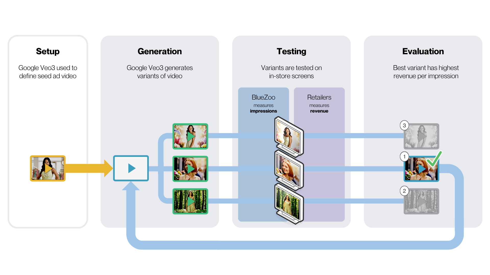

# Video Ad Optimization Agent (`react-ad-flow`)

A privacy-first audience measurement and generative AI agent system for optimizing in-store digital video advertising at point of sale.

Developed in collaboration between Google and BlueZoo, this recipe demonstrates how Google's generative media technologies (**Gemini Omni Flash** video synthesis and **Gemini Image** models) combine with real-time audience analytics (**BlueZoo** sensor data) to establish a continuous, data-driven creative optimization loop.

---

## Table of Contents

- [1. Setup Instructions & User Guide](#1-setup-instructions--user-guide)
  - [Prerequisites](#prerequisites)
  - [Local Development Quick Start](#local-development-quick-start)
  - [Google Cloud Infrastructure Setup](#google-cloud-infrastructure-setup)
- [2. Deployment Strategies](#2-deployment-strategies)
  - [Deployment Comparison](#deployment-comparison)
  - [Strategy 1: Deploy to Google Cloud Run (Web UI & A2A)](#strategy-1-deploy-to-google-cloud-run-web-ui--a2a)
  - [Strategy 2: Deploy to Vertex AI Agent Engine (Managed Reasoning Engine)](#strategy-2-deploy-to-vertex-ai-agent-engine-managed-reasoning-engine)
- [3. System Architecture & Workflows](#3-system-architecture--workflows)
  - [The Optimization Loop](#the-optimization-loop)
  - [Multi-Agent Architecture](#multi-agent-architecture)
  - [End-to-End System Architecture](#end-to-end-system-architecture)
  - [Technology Foundation](#technology-foundation)
- [4. Environment Variables Reference](#4-environment-variables-reference)
- [5. Testing & Verification](#5-testing--verification)
- [6. Troubleshooting](#6-troubleshooting)

---

## 1. Setup Instructions & User Guide

### Prerequisites

Before you begin, ensure you have the following installed and configured:

| Requirement | Supported Version | Notes |
| :--- | :--- | :--- |
| **Python** | `>=3.11, <3.14` | Required by Google ADK |
| **uv** | Latest | Recommended Python package and project manager — [Install guide](https://docs.astral.sh/uv/getting-started/installation/) |
| **Google Cloud SDK (`gcloud`)** | Latest | Authenticated with your Google Cloud account — [Install guide](https://cloud.google.com/sdk/docs/install) |
| **Google Cloud Project** | Vertex AI Enabled | Access to `gemini-3.7-flash` and `gemini-omni-flash-preview` |
| **Google Maps API Key** | Optional | Required for store locator and static map visualizations |

> [!NOTE]
> All commands in this guide should be executed from the recipe directory:
> `contrib/python/react-ad-flow/`.

---

### Local Development Quick Start

#### 1. Install Dependencies
Using `uv`, synchronize the lockfile and create your virtual environment:
```bash
uv sync
```

#### 2. Configure Environment Variables
Copy the template configuration file:
```bash
cp .env.example .env
```

Select your environment configuration:

##### Option A: Vertex AI (Recommended)
```env
GOOGLE_GENAI_USE_VERTEXAI=TRUE
GOOGLE_CLOUD_PROJECT=your-gcp-project-id
GOOGLE_CLOUD_LOCATION=global
AGENT_MODEL=gemini-3.7-flash
VIDEO_GEN_MODEL=gemini-omni-flash-preview
OMNI_EDIT_MODEL=gemini-omni-flash-preview
GCS_BUCKET=your-gcs-bucket-name
ENABLE_OMNI_EDIT=true
# Optional:
GOOGLE_MAPS_API_KEY=your-maps-api-key
APP_MODE=demo
```

##### Option B: Google AI Studio
```env
GOOGLE_GENAI_USE_VERTEXAI=FALSE
GOOGLE_API_KEY=your-gemini-api-key
AGENT_MODEL=gemini-3.7-flash
VIDEO_GEN_MODEL=gemini-omni-flash-preview
OMNI_EDIT_MODEL=gemini-omni-flash-preview
ENABLE_OMNI_EDIT=true
# Optional:
GOOGLE_MAPS_API_KEY=your-maps-api-key
APP_MODE=demo
```

#### 3. Run the Agent Interactively via ADK CLI
Test and chat with the coordinator agent directly in your terminal:
```bash
uv run adk run app
```

#### 4. Run the Local Serving Server (FastAPI + A2A)
Start the local Uvicorn web server hosting the FastAPI endpoints and A2A service:
```bash
uv run uvicorn app.fast_api_app:app --host 0.0.0.0 --port 8000
```
Key endpoints:
- `http://localhost:8000/health`: Health status probe
- `http://localhost:8000/.well-known/agent.json`: A2A agent card specification
- `http://localhost:8000/a2a`: A2A communication protocol endpoint

#### 5. Run via Docker Locally
You can build and run the recipe container locally:
```bash
docker build -t react-ad-flow .
docker run -p 8080:8080 --env-file .env react-ad-flow
```

---

### Google Cloud Infrastructure Setup

Before deploying to Google Cloud, set up your active project, APIs, and Cloud Storage bucket.

#### 1. Authenticate with Google Cloud
```bash
gcloud auth login
gcloud auth application-default login

export GOOGLE_CLOUD_PROJECT="your-project-id"
gcloud config set project "$GOOGLE_CLOUD_PROJECT"
```

#### 2. Enable Required APIs
```bash
gcloud services enable \
  run.googleapis.com \
  storage.googleapis.com \
  aiplatform.googleapis.com \
  generativelanguage.googleapis.com
```

#### 3. Automated GCP Setup Script
This recipe includes an automated setup script ([scripts/setup_gcp.sh](scripts/setup_gcp.sh)) that provisions the Cloud Storage bucket (`gs://${GOOGLE_CLOUD_PROJECT}-react-ad-flow-assets`) and uploads catalog seed images:

```bash
# Provision infrastructure and upload seed assets
./scripts/setup_gcp.sh

# Provision infrastructure without uploading assets
./scripts/setup_gcp.sh --no-assets

# Verify bucket, assets, and service permissions
./scripts/setup_gcp.sh --verify
```

#### 4. Cloud Storage Layout
When running in cloud mode (`GCS_BUCKET` configured), the agent uses the following bucket structure:
- `gs://${GCS_BUCKET}/seed-images/`: Source product catalog images
- `gs://${GCS_BUCKET}/generated/`: Gemini Omni Flash-generated video ads (`.mp4`) and thumbnails (`.png`)

#### 5. Grant Permissions for Agent Engine
If you plan to deploy to Vertex AI Agent Engine, grant `roles/storage.objectAdmin` to the Reasoning Engine service agent:
```bash
PROJECT_NUMBER=$(gcloud projects describe "$GOOGLE_CLOUD_PROJECT" --format='value(projectNumber)')

gcloud projects add-iam-policy-binding "$GOOGLE_CLOUD_PROJECT" \
  --member="serviceAccount:service-${PROJECT_NUMBER}@gcp-sa-aiplatform-re.iam.gserviceaccount.com" \
  --role="roles/storage.objectAdmin"
```

---

## 2. Deployment Strategies

### Deployment Comparison

| Strategy | Best For | Web UI | Session Management | Scaling |
| :--- | :--- | :--- | :--- | :--- |
| **Strategy 1: Google Cloud Run** | Demos, interactive testing, A2A | Yes (`/dev-ui`) | In-memory or Redis | Serverless (0 to N) |
| **Strategy 2: Vertex AI Agent Engine** | Managed production, reasoning engine API | No (SDK/API only) | Fully managed by Vertex AI | Automatic |

---

### Strategy 1: Deploy to Google Cloud Run (Web UI & A2A)

Cloud Run provides a containerized serverless hosting environment with built-in ADK Web UI, REST endpoints, and A2A service.

#### Option A: Automated Deployment Script
Use the included deployment script ([scripts/deploy.sh](scripts/deploy.sh)):

```bash
# Deploy with default settings (private access, us-central1)
./scripts/deploy.sh

# Preview deployment commands without executing
./scripts/deploy.sh --dry-run

# Deploy with public unauthenticated access
./scripts/deploy.sh --public

# Deploy with Cloud Trace enabled for observability
./scripts/deploy.sh --trace
```

You can pass environment variable overrides to customize the deployment:
```bash
GOOGLE_CLOUD_PROJECT="your-project-id" \
CLOUD_RUN_REGION="us-central1" \
GCS_BUCKET="your-bucket-name" \
SERVICE_NAME="react-ad-flow" \
./scripts/deploy.sh
```

#### Option B: Manual ADK CLI Deployment
Invoke `adk deploy cloud_run` directly with recommended production flags:
```bash
adk deploy cloud_run \
  --project="$GOOGLE_CLOUD_PROJECT" \
  --region="us-central1" \
  --service_name="react-ad-flow" \
  --app_name="react_ad_flow" \
  --with_ui \
  --artifact_service_uri="gs://${GCS_BUCKET}" \
  app \
  -- \
  --set-env-vars=GCS_BUCKET="${GCS_BUCKET}",GOOGLE_GENAI_USE_VERTEXAI=True,GOOGLE_CLOUD_PROJECT="${GOOGLE_CLOUD_PROJECT}",GOOGLE_CLOUD_LOCATION=global,APP_MODE=demo \
  --memory=2Gi \
  --cpu=2 \
  --timeout=600 \
  --allow-unauthenticated
```

#### Option C: Direct Container Deployment (`gcloud run deploy`)
Build and deploy from the included [Dockerfile](Dockerfile):
```bash
gcloud run deploy react-ad-flow \
  --source . \
  --region us-central1 \
  --memory 2Gi \
  --cpu 2 \
  --timeout 600 \
  --set-env-vars GCS_BUCKET="${GCS_BUCKET}",GOOGLE_GENAI_USE_VERTEXAI=True,GOOGLE_CLOUD_PROJECT="${GOOGLE_CLOUD_PROJECT}",GOOGLE_CLOUD_LOCATION=global,APP_MODE=demo \
  --allow-unauthenticated
```

#### Option D: Agent Garden CLI (`agents-cli`)
Deploy via the Google Agents CLI using the project manifest ([agents-cli-manifest.yaml](agents-cli-manifest.yaml)):
```bash
agents-cli deploy
```

#### Post-Deployment & Access Points
```bash
# Retrieve service URL
gcloud run services describe react-ad-flow \
  --region=us-central1 \
  --format='value(status.url)'

# Tail logs
gcloud run services logs read react-ad-flow \
  --region=us-central1 --limit=50
```
- **Interactive ADK Web UI**: `https://<SERVICE_URL>/dev-ui`
- **FastAPI / A2A API**: `https://<SERVICE_URL>`

---

### Strategy 2: Deploy to Vertex AI Agent Engine (Managed Reasoning Engine)

Vertex AI Agent Engine provides a fully managed runtime with persistent conversation sessions, integrated memory banks, and direct SDK query interfaces.

#### Deployment via Python SDK
Deploy using [scripts/deploy_ae_inline.py](scripts/deploy_ae_inline.py):
```bash
# Fresh deployment to Agent Engine
uv run python scripts/deploy_ae_inline.py \
  --project "$GOOGLE_CLOUD_PROJECT" \
  --region us-central1 \
  --bucket "$GCS_BUCKET"

# Preview deployment without executing
uv run python scripts/deploy_ae_inline.py \
  --project "$GOOGLE_CLOUD_PROJECT" \
  --region us-central1 \
  --dry-run
```

#### Querying the Deployed Agent Engine

##### Python SDK
```python
import vertexai
from vertexai.preview import reasoning_engines

vertexai.init(project="your-project-id", location="us-central1")
remote_agent = reasoning_engines.ReasoningEngine(
    "projects/PROJECT_ID/locations/us-central1/reasoningEngines/RESOURCE_ID"
)

response = remote_agent.query(
    message="Create a new ad campaign for the Blue Floral Maxi Dress targeting urban shoppers."
)
print(response)
```

##### REST API
```bash
TOKEN=$(gcloud auth print-access-token)

curl -X POST \
  "https://us-central1-aiplatform.googleapis.com/v1/projects/${GOOGLE_CLOUD_PROJECT}/locations/us-central1/reasoningEngines/${AGENT_ENGINE_ID}:query" \
  -H "Authorization: Bearer $TOKEN" \
  -H "Content-Type: application/json" \
  -d '{"message": "List all active campaigns"}'
```

##### Managing Deployments
```bash
# List all deployed reasoning engines
gcloud ai reasoning-engines list --region=us-central1

# Delete a deployment
gcloud ai reasoning-engines delete AGENT_ENGINE_ID --region=us-central1
```

---

## 3. System Architecture & Workflows

### The Optimization Loop

Creating compelling video advertisements has never been easier. Knowing **which advertisements actually drive sales** is the harder problem.

Traditional in-store campaigns require significant creative resources, production cycles, and costs. Determining which advertisement drives the best sales lift historically relied on manual guesswork.

<p align="center">
  <a href="./assets/high-level-system.png">
    
  </a>
</p>

This recipe establishes a continuous, data-driven optimization cycle:
1. **Candidate Generation**: A human specialist uploads product seed images and creative descriptors. The system generates multiple candidate video advertisements using **Gemini Omni Flash** and Gemini image models.
2. **In-Store Playback**: Video ads are scheduled and deployed across in-store digital screens.
3. **Audience Measurement**: **BlueZoo** optical sensors measure audience impressions and dwell times without capturing personally identifiable information.
4. **Performance Normalization**: Retailers calculate **Revenue Per Impression (RPI)** by dividing point-of-sale (POS) revenue for each advertised product by the number of impressions delivered during the playback window.
5. **Creative Refinement**: The agent identifies top-performing videos and uses their visual properties (mood, camera style, setting) as the winning formula for the next generation cycle.

<p align="center">
  <a href="./assets/executive-journey.png">
    
  </a>
</p>

---

### Multi-Agent Architecture

The solution is orchestrated by a multi-agent system built on the Google Agent Development Kit (ADK):

```
Coordinator Agent (root_agent)
├── Campaign Agent   — Campaign CRUD, store locations, and geographic metadata
├── Media Agent      — Scene images, prompt composition, and Gemini Omni Flash video generation
├── Review Agent     — Candidate activation, HITL review, and Omni Flash visual video edits
└── Analytics Agent  — Impression metrics, POS correlation, RPI computation, and chart generation
```

1. **Coordinator Agent (`root_agent`)**: Interprets user intent and routes tasks across specialist sub-agents.
2. **Campaign Agent**: Manages retail campaigns, targets store locations, and organizes product catalogs.
3. **Media Agent**: Implements the two-stage media pipeline:
   - **Stage 1 (Scene Image)**: Generates high-fidelity first-frame scene images using Gemini image models (`gemini-3-pro-image`).
   - **Stage 2 (Video Animation)**: Animates the scene image into a 4-second 9:16 vertical video using Gemini Omni Flash (`gemini-omni-flash-preview`).
4. **Review Agent**: Handles human-in-the-loop candidate approval and post-generation visual editing (e.g. changing shirt color or lighting) via Gemini Omni Flash's visual editing capabilities.
5. **Analytics Agent**: Computes Revenue Per Impression (RPI), correlates dwell times with sales lift, and generates visual charts and map views.

---

### End-to-End System Architecture

<p align="center">
  <a href="./assets/system-architecture.jpeg">
    
  </a>
</p>

---

### Technology Foundation

- **Gemini Omni Flash Video Synthesis & Editing**: Enables rapid, low-latency creation and targeted visual editing of vertical 9:16 video ads at enterprise scale.
- **BlueZoo Audience Measurement**: Provides privacy-first audience counting and dwell time telemetry to close the feedback loop with objective sales-lift metrics.
- **NRF & InfoComm Demonstrated**: Originally showcased as a joint technology demonstration by Google and BlueZoo at NRF and InfoComm, proving the viability of autonomous in-store creative optimization.

---

## 4. Environment Variables Reference

| Variable | Required | Default | Description |
| :--- | :--- | :--- | :--- |
| `GOOGLE_CLOUD_PROJECT` | Yes | — | Google Cloud project ID |
| `GOOGLE_GENAI_USE_VERTEXAI` | Yes | `TRUE` | `TRUE` for Vertex AI backend, `FALSE` for AI Studio |
| `GOOGLE_CLOUD_LOCATION` | Optional | `global` | Location for Gemini models (`global` required for Gemini 3.x) |
| `AGENT_MODEL` | Optional | `gemini-3.7-flash` | Primary coordinator agent model |
| `VIDEO_GEN_MODEL` | Optional | `gemini-omni-flash-preview` | Stage 2 video animation model (Gemini Omni Flash) |
| `OMNI_EDIT_MODEL` | Optional | `gemini-omni-flash-preview` | Post-generation visual editing model (Gemini Omni Flash) |
| `IMAGE_GENERATION_MODEL` | Optional | `gemini-3-pro-image` | Stage 1 scene image generation model |
| `ENABLE_OMNI_EDIT` | Optional | `false` | Enable visual video editing tools in Review Agent |
| `GCS_BUCKET` | Optional | — | Cloud Storage bucket for video ads, thumbnails, and artifacts |
| `GOOGLE_MAPS_API_KEY` | Optional | — | Google Maps API key for store locator and static map views |
| `APP_MODE` | Optional | `demo` | `demo` (seeded mock data) or `connected` (live telemetry) |

---

## 5. Testing & Verification

Run the test suites using `uv run pytest`:

### 1. Run Complete Test Suite
```bash
uv run pytest
```

### 2. Run Unit Tests Only
```bash
uv run pytest tests/unit
```

### 3. Run CI Runnability Verification Test
```bash
uv run pytest tests/test_runnability.py
```

### 4. Run Media Models Smoke Test
Verify live access to Gemini image models and Gemini Omni Flash video generation:
```bash
uv run python scripts/smoke_media_models.py
```

---

## 6. Troubleshooting

### 1. Gemini Model Not Found (404)
```text
Publisher Model `gemini-3.7-flash` was not found
```
**Resolution**: Gemini 3.x models are served globally. Ensure `GOOGLE_CLOUD_LOCATION=global` is set in your environment variables.

### 2. GCS Permission Denied on Agent Engine (403)
```text
google.api_core.exceptions.Forbidden: 403 Access Denied
```
**Resolution**: Grant `roles/storage.objectAdmin` to the Reasoning Engine service agent:
```bash
PROJECT_NUMBER=$(gcloud projects describe "$GOOGLE_CLOUD_PROJECT" --format='value(projectNumber)')

gcloud projects add-iam-policy-binding "$GOOGLE_CLOUD_PROJECT" \
  --member="serviceAccount:service-${PROJECT_NUMBER}@gcp-sa-aiplatform-re.iam.gserviceaccount.com" \
  --role="roles/storage.objectAdmin"
```

### 3. Cloud Run Artifact Permission Denied
```text
PermissionError: [Errno 13] Permission denied: '/app/agents/.adk'
```
**Resolution**: The root filesystem of Cloud Run is read-only. Supply `--artifact_service_uri=gs://${GCS_BUCKET}` so ADK artifacts are persisted directly to Cloud Storage (handled automatically by `scripts/deploy.sh`).
