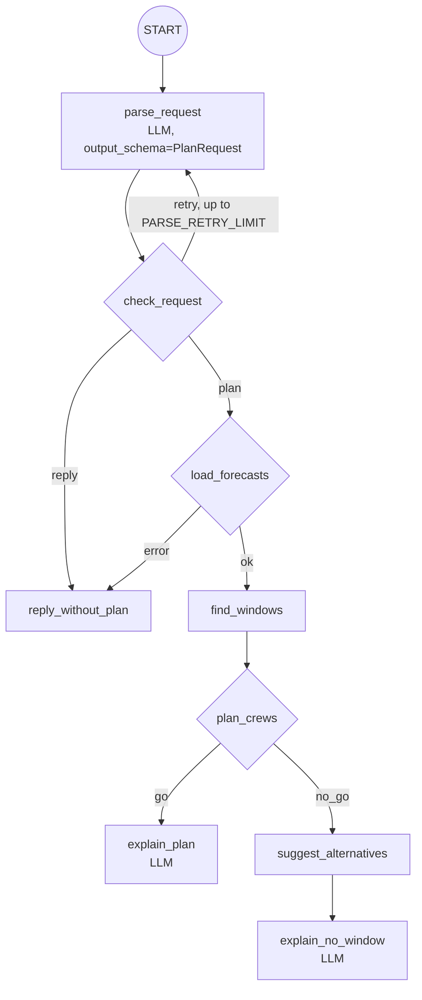

# weathernext-forecast-agent

**Plan wind-turbine maintenance from ensemble weather forecasts, with the
probability that each work window stays safe.**

Wind-farm maintenance is limited by weather. A main-component crane lift
(blade, hub or gearbox exchange) needs a long, calm, dry daylight window; blade
repairs need dry air for resin to cure; even routine nacelle service has a wind
limit for climbing. Mobilizing a large crane and crew for a window that does not
hold is expensive, and a day that "looks fine" on the median forecast can
still have roughly one ensemble member in six breaking the lift limit (see
Wednesday at Whitelee below).

This recipe gives an operations planner an ADK 2.0 agent that answers
questions like *"Which day this week can the crane lift at Whitelee go ahead,
and how sure are we?"* from an **ensemble forecast**: it counts how many
ensemble members keep every hour of the job within the task's wind, gust and
rain limits. The production data source is
[WeatherNext](https://developers.google.com/weathernext) on BigQuery; out of
the box the recipe runs on a bundled **real ECMWF ensemble snapshot** so it
works without any cloud access. The model never computes weather numbers
itself.

## The decision this recipe makes

> **Blade exchange at Whitelee Wind Farm, Scotland, Tuesday 20 – Saturday 24
> October 2026.** A damaged blade needs a main-crane lift: 8 consecutive
> daylight hours with hub-height wind ≤ 10 m/s, gusts ≤ 14 m/s and rain
> ≤ 0.5 mm/h. Go if the whole window holds in at least 80% of ensemble
> members. The same contractor also has to place **two crane crews across
> three farms** (Whitelee, Clyde, Black Law) that week.

The answer from the bundled forecast (ECMWF IFS ensemble, run 2026-10-19
06:00 UTC, 51 members):

| Whitelee, 8-hour lift window (BST) | P(safe) | Members safe | What fails the rest |
| --- | --- | --- | --- |
| **Thu 22 Oct 08:00–16:00 — go** | **98.0%** | 50/51 | rain (2.0%) |
| Wed 21 Oct 08:00–16:00 — backup | 84.3% | 43/51 | rain 13.7%, wind 2.0% |
| Tue 20 Oct 07:00–15:00 — no-go | 64.7% | 33/51 | rain 35.3% |

Saturday is out: the daily ensemble spread at Whitelee goes from a p90
hub-height wind of 11.9 m/s on Thursday to 19.4 m/s on Saturday.

For the two-crew question, Thursday is also the best lift day at Clyde and
Black Law (98.0%, 50/51 each), and two crews cannot cover three farms in one
day. The planner sends crew 2 to Black Law on Thursday, and crew 1 to
Whitelee on Wednesday (84.3%) and then Clyde on Thursday (98.0%), keeping a
12-hour travel buffer: expected completed lifts 2.8 of 3. The answer names
Whitelee's Thursday window (98.0%) as the backup if crew 1's Wednesday lift
slips.

### Sites

| Site | Coordinates (WGS 84) | Hub height used | Source |
| --- | --- | --- | --- |
| Whitelee Wind Farm, East Renfrewshire | 55.6728, −4.2856 | 65 m | [Wikipedia](https://en.wikipedia.org/wiki/Whitelee_Wind_Farm) (coordinates, hub height) |
| Clyde Wind Farm, South Lanarkshire | 55.4672, −3.6544 | 80 m (assumed) | [Wikipedia](https://en.wikipedia.org/wiki/Clyde_Wind_Farm) (coordinates) |
| Black Law Wind Farm, South Lanarkshire | 55.7669, −3.7389 | 80 m (assumed) | [Wikipedia](https://en.wikipedia.org/wiki/Black_Law_Wind_Farm) (coordinates) |

Coordinates were retrieved on 2026-10-19. Hub height is published in the
cited source for Whitelee only; replace the assumed values with the
operator's. All three sites are on British Summer Time (UTC+1) for the whole
window (BST ends on 25 October). The recipe has no affiliation with the
owners or operators of these farms.

## Architecture: an ADK 2.0 graph workflow

The root of the app is an ADK 2.0 `Workflow`
([`app/agent.py`](app/agent.py)). Deterministic steps are **function nodes**;
only three nodes call Gemini, all as `Agent(mode="single_turn")`:



| Node | Kind | What it does |
| --- | --- | --- |
| `parse_request` | LLM (`single_turn`, Pydantic `output_schema`) | Turns the planner's message (and follow-ups) into `PlanRequest`: task type, sites, crews, horizon, hours |
| `check_request` | function, routes | Validates ids and numbers; sends errors back to the parser once (`retry`, bounded by `PARSE_RETRY_LIMIT`), else `plan` or `reply` |
| `reply_without_plan` | function | Deterministic help text: sites, task limits, example questions, or the validation/data error |
| `load_forecasts` | function, routes | Loads the ensemble for every site (snapshot or BigQuery); `error` if data access fails |
| `find_windows` | function | Scores every allowed window per site with [`analysis.py`](app/analysis.py): P(all hours within limits) across ensemble members |
| `plan_crews` | function, routes | Assigns crews (one job per site, travel buffer, go threshold); `go` if any crew is assigned, else `no_go` |
| `suggest_alternatives` | function | For `no_go`: best window for every other task type, plus a daily p10/p50/p90 outlook per site |
| `explain_plan` / `explain_no_window` | LLM (`single_turn`, `include_contents="none"`) | Narrate only the numbers in their JSON input, with local times, members in support and the main risk |

Task limits live in config ([`app/config.py`](app/config.py)), overridable with
`TASK_LIMITS_JSON` so you can paste in the limits from your own lift plans and
OEM manuals:

| Task type | Hub wind | Gust | Rain (1 h) | Hours | Go threshold |
| --- | --- | --- | --- | --- | --- |
| `main_component_lift` | ≤ 10 m/s | ≤ 14 m/s | ≤ 0.5 mm | 8, daylight | 80% |
| `blade_repair` | ≤ 12 m/s | ≤ 15 m/s | ≤ 0.1 mm | 6, daylight | 70% |
| `nacelle_service` | ≤ 18 m/s | ≤ 22 m/s | ≤ 2.0 mm | 4, daylight | 70% |

These are illustrative planning values, not OEM or regulatory limits.
"Daylight" means 07:00–19:00 site local time. Wind is moved from 100 m to
each site's hub height with a power-law shear profile (`SHEAR_EXPONENT`,
default 0.14), and gusts are estimated as `GUST_FACTOR` (default 1.35) times
the hub-height mean wind, because WeatherNext does not publish a gust
variable.

There is deliberately **no human-in-the-loop `RequestInput` step**: the
workflow only recommends, it never books crews or changes anything, and a
paused task would break the single request/response chat turn that the Gemini
agent and Gemini Enterprise use over A2A. Approval stays with the people on
site (see [Safety and limitations](#safety-and-limitations)).

### Example run

Live run on 2026-10-19 with `MODEL_NAME=gemini-3.7-flash` on the bundled
snapshot. Prompt: *"We need to swap a damaged blade at Whitelee this week
(Tue 20 to Sat 24 October). Which day can the main crane lift go ahead, and
how sure are you?"*

- Trace: `parse_request` → `check_request` (`plan`) → `load_forecasts`
  (`ok`) → `find_windows` → `plan_crews` (`go`) → `explain_plan`; 2 model
  calls, 19.4 s.
- Answer: crew 1 to Whitelee on **Thursday 22 Oct 08:00–16:00 BST, 98%
  (50/51 members)**, main residual risk rain (fail fraction 0.02); backup
  Wednesday 21 Oct 08:00–16:00, 84.3% (43/51), rain fail fraction 0.137;
  forecast run and source named; decision-support line at the end.

The two-crew follow-up (*"We have 2 crane crews for blade exchanges at
Whitelee, Clyde and Black Law this week. Which farm when?"*) took the same
route in 21.4 s and returned the plan in the table above (expected completed
jobs 2.8). A request for Tuesday only takes the `no_go` route (best window
64.7%) and offers nacelle service (100%, 51/51) as work the crew can do
instead; that path is covered by the unit tests.

## What you will learn

- Building an **ADK 2.0 graph `Workflow`**: function nodes for the math,
  `single_turn` LLM nodes with a Pydantic `output_schema`, conditional routes
  (`Event(route=...)` with dict edges) and a bounded retry loop back to the
  parser.
- Grounding an agent in **probabilistic data**: probabilities come from
  counting ensemble members, so the agent can say "50 of 51 members" instead
  of guessing.
- Querying **WeatherNext on BigQuery** with a parameterized, partition-pruned
  query, and handling its precomputed quantiles honestly.
- Serving the agent over **A2A JSON-RPC and HTTP+JSON**, the bindings Gemini
  Enterprise and the Gemini agent (via Agent Registry) use.

## Requirements

Before you begin, ensure you have:
- **uv**: Python package manager - [Install](https://docs.astral.sh/uv/getting-started/installation/)
- Access to Gemini through Vertex AI or a Google AI Studio API key.
- Optional: WeatherNext data access and a Google Cloud project with BigQuery
  (see [Data access](#data-access)).

## Setup

> **Note**: All commands below must be run from the recipe root directory (`contrib/python/weathernext-forecast-agent/`).

1. Install required packages:
   ```bash
   uv sync
   ```

2. Set up environment variables. Copy `.env.example` to `.env` and configure
   either Vertex AI (`GOOGLE_CLOUD_PROJECT`, `GOOGLE_GENAI_USE_VERTEXAI=True`)
   or `GEMINI_API_KEY`:
   ```bash
   cp .env.example .env
   ```

   | Variable | Default | Purpose |
   | --- | --- | --- |
   | `MODEL_NAME` | `gemini-3.7-flash` | Model for the parse and explain nodes |
   | `PARSE_RETRY_LIMIT` | `1` | Times an invalid parsed request goes back to the parser |
   | `WEATHERNEXT_SOURCE` | `sample` | `sample` (bundled snapshot) or `bigquery` |
   | `WEATHERNEXT_BQ_TABLE` | — | `project.dataset.weathernext_3_0_0_0p1deg` |
   | `WEATHERNEXT_BQ_PROJECT` | client default | Project billed for queries |
   | `WEATHERNEXT_INIT_TIME` | latest 6-hourly init | Pin a forecast run |
   | `WEATHERNEXT_MAX_HOURS` | `120` | Lead hours to load (≤ 360) |
   | `WEATHERNEXT_BQ_TIMEOUT_SECONDS` | `60` | BigQuery query timeout (client and server) |
   | `SITES_JSON` | bundled `app/data/sites.json` | Your wind farms |
   | `SAMPLE_FORECAST_JSON` | bundled snapshot | Your own member-level ensemble |
   | `TASK_LIMITS_JSON` | — | Override or add task limits |
   | `GUST_FACTOR` | `1.35` | Gust / hub-height mean wind |
   | `SHEAR_EXPONENT` | `0.14` | 100 m → hub height wind shear |

## Run

Start the agent in the terminal:

```bash
uv run adk run app
# > Which day this week can the crane lift at Whitelee go ahead?
# > We have 2 crane crews for blade exchanges at Whitelee, Clyde and Black Law. Which farm when?
# > What about blade repair instead?
```

Or start the local web server and open the ADK dev UI:

```bash
uv run uvicorn app.fast_api_app:app --reload
```

## Data access

### Production: WeatherNext 3 on BigQuery

WeatherNext 3 forecasts are published on Google Cloud Storage (Zarr), Earth
Engine and BigQuery
([quick start](https://developers.google.com/weathernext/guides/access-forecast)).
Access is by request: submit the
[WeatherNext Data Request form](https://docs.google.com/forms/d/e/1FAIpQLSeCf1JY8G78UDWzbm0ly9kJxfSjUIJT5WyMR_HiNqCm-IHIBg/viewform);
one approval covers all three surfaces. Then subscribe to the
[WeatherNext 3 BigQuery Analytics Hub listing](https://developers.google.com/weathernext/guides/bigquery),
which links the tables into a dataset in your project, and set:

```bash
WEATHERNEXT_SOURCE=bigquery
WEATHERNEXT_BQ_TABLE=your-project.your_dataset.weathernext_3_0_0_0p1deg
```

The loader ([`app/forecast.py`](app/forecast.py)) runs two queries. First the
latest 6-hourly run (the runs with a 15-day horizon), unless
`WEATHERNEXT_INIT_TIME` pins one:

```sql
SELECT MAX(init_time) AS init_time
FROM `YOUR_PROJECT.YOUR_DATASET.weathernext_3_0_0_0p1deg`
WHERE init_time >= TIMESTAMP_SUB(CURRENT_TIMESTAMP(), INTERVAL 2 DAY)
  AND EXTRACT(HOUR FROM init_time AT TIME ZONE 'UTC') IN (0, 6, 12, 18)
```

Then, per site, the hourly ensemble statistics of the 0.1° cell that contains
it. For Whitelee the parameters are `@init_time` = the run above,
`@lon = -4.2856`, `@lat = 55.6728`, `@max_hours = 120`:

```sql
SELECT
  t.init_time AS init_time,
  f.time AS time,
  f.hours AS hours,
  f.wind_speed_100m_p10 AS wind_speed_100m_p10,
  f.wind_speed_100m_p25 AS wind_speed_100m_p25,
  f.wind_speed_100m_p50 AS wind_speed_100m_p50,
  f.wind_speed_100m_p75 AS wind_speed_100m_p75,
  f.wind_speed_100m_p90 AS wind_speed_100m_p90,
  f.total_precipitation_1hr_p10 AS total_precipitation_1hr_p10,
  f.total_precipitation_1hr_p25 AS total_precipitation_1hr_p25,
  f.total_precipitation_1hr_p50 AS total_precipitation_1hr_p50,
  f.total_precipitation_1hr_p75 AS total_precipitation_1hr_p75,
  f.total_precipitation_1hr_p90 AS total_precipitation_1hr_p90
FROM `YOUR_PROJECT.YOUR_DATASET.weathernext_3_0_0_0p1deg` AS t
CROSS JOIN UNNEST(t.forecast) AS f
WHERE t.init_time = @init_time
  AND ST_INTERSECTS(t.geography_polygon, ST_GEOGPOINT(@lon, @lat))
  AND f.hours <= @max_hours
ORDER BY f.time
```

Both filter on `init_time`, the partition column, so only one run is scanned.
Values are bound as query parameters; the table id is validated before it is
put in the SQL. Precipitation is converted from metres to millimetres. Each
query is bounded by `WEATHERNEXT_BQ_TIMEOUT_SECONDS` (client wait and BigQuery
job timeout), and results are cached per site per process. A unit test checks
that this README shows exactly the SQL the loader sends.

> [!IMPORTANT]
> The BigQuery listing publishes **precomputed ensemble statistics** (mean
> and percentiles), not individual members. From quantiles alone the
> probability that a whole multi-hour window is safe cannot be computed
> exactly, so in this mode the tools report `probability_safe` (the smallest
> per-hour, per-variable marginal probability: exact only if the conditions
> are perfectly correlated, otherwise optimistic) **and**
> `probability_safe_lower_bound` (the Fréchet bound, valid for any
> correlation). Use member-level data from the
> [Zarr full-ensemble store](https://developers.google.com/weathernext/guides/gcs)
> for exact joint probabilities.

The table and column names follow the WeatherNext documentation. The BigQuery
path is covered by unit tests with a fake client; it has not been run against
the live listing by the author, who has no WeatherNext access. Check the
schema of your linked table (`SELECT * FROM ... LIMIT 1`) before relying on it.

**Terms**: real-time WeatherNext data (less than 1 hour old and the future) is
governed by the
[GDM Real-Time Weather Forecasting Experimental Data Terms of Use](https://storage.googleapis.com/weathernext-public/terms-of-use.pdf);
historical data (1 hour old or more) is licensed under CC BY 4.0. See
[Terms of Service and Disclaimers](https://developers.google.com/weathernext/guides/disclaimers).

### Default: bundled real ensemble snapshot (stand-in for WeatherNext)

`app/data/forecast_snapshot.json` is a **real** forecast, not synthetic data,
used as a credential-free stand-in for WeatherNext. It is **not** WeatherNext
output.

| | |
| --- | --- |
| Model | ECMWF IFS 0.25° ensemble: control + 50 perturbed members |
| Run | 2026-10-19 06:00 UTC |
| Retrieved | 2026-10-19 20:36 UTC from the [Open-Meteo Ensemble API](https://open-meteo.com/en/docs/ensemble-api) (`models=ecmwf_ifs025`) |
| Window | 2026-10-20 00:00 – 2026-10-24 23:00 UTC, hourly (native 3-hourly, interpolated by Open-Meteo) |
| Variables | `wind_speed_100m` (m/s), `precipitation` (mm in the preceding hour) |
| Grid | Nearest 0.25° cell to each site (recorded in the file's `provenance`) |
| Licence | [CC BY 4.0](https://creativecommons.org/licenses/by/4.0/); underlying ECMWF open data CC BY 4.0 |
| Changes | 2 variables and 3 cells selected, values rounded (0.1 m/s, 0.01 mm), converted to member arrays |

Weather data by [Open-Meteo.com](https://open-meteo.com/), containing
[ECMWF open data](https://www.ecmwf.int/en/forecasts/datasets/open-data).
The same provenance is stored in the file itself. Open-Meteo's free API is for
non-commercial use; this snapshot is shared as educational content under its
CC BY 4.0 licence. Fetch your own data under the terms that apply to you.

To use your own member-level ensemble (for example WeatherNext's raw 64-member
Zarr output), write a file in the same format and point `SAMPLE_FORECAST_JSON`
and `SITES_JSON` at it.

## Deploy and use it where your team works

The recipe ships a `Dockerfile` and serves the standard ADK FastAPI app, so
it runs on Cloud Run:

```bash
gcloud run deploy weathernext-forecast-agent --source . --region us-central1 \
  --set-env-vars MODEL_NAME=gemini-3.7-flash,GOOGLE_GENAI_USE_VERTEXAI=True
```

For live data, add `WEATHERNEXT_SOURCE=bigquery` and `WEATHERNEXT_BQ_TABLE`,
and grant the service account `roles/bigquery.jobUser` on the billing project
and `roles/bigquery.dataViewer` on the linked dataset. Set `APP_URL` to the
service URL so the A2A agent card points at it.

### A2A endpoints

All under `APP_URL` + `/a2a/app`:

| Binding | Version | Routes |
| --- | --- | --- |
| JSON-RPC | 1.0 and 0.3 | `POST /a2a/app` (`SendMessage`, `message/send`, ...) |
| HTTP+JSON | 0.3 | `GET /a2a/app/v1/card`, `POST /a2a/app/v1/message:send`, `POST /a2a/app/v1/message:stream` |
| HTTP+JSON | 1.0 | `POST /a2a/app/message:send`, `POST /a2a/app/message:stream`, ... |
| Agent card | — | `GET /a2a/app/.well-known/agent-card.json` (lists all four interfaces) |

A v0.3 HTTP+JSON `message:send` without a `configuration` waits for the
answer (as JSON-RPC does); send `"configuration": {"blocking": false}` to get
the task back immediately.

### Use it in the Gemini agent

The Gemini agent reaches third-party agents through
[Agent Registry](https://docs.cloud.google.com/gemini-enterprise-agent-platform/govern/agent-registry),
which invokes A2A agents over the **HTTP+JSON** binding (`GET /v1/card`,
`POST /v1/message:send` with `role: ROLE_USER`, `content[].text` and a unique
`messageId`).

1. Deploy to Cloud Run as above, with `APP_URL` set.
2. Register it as an A2A agent in Gemini Enterprise / Agent Registry by
   following
   [Register and manage A2A agents](https://docs.cloud.google.com/gemini/enterprise/docs/register-and-manage-an-a2a-agent)
   (it covers the Cloud Run invoker role for the Discovery Engine service
   agent and optional OAuth).
3. Call it from the Gemini agent, or programmatically through its registry
   endpoint, as described in
   [Call an agent using its registry A2A endpoint](https://docs.cloud.google.com/gemini/enterprise/docs/invoke-agent-a2a).
4. For Google Chat, follow
   [Build a Google Chat app with a Gemini Enterprise AI agent](https://developers.google.com/workspace/chat/quickstart-ge-agent).

Follow-up questions ("what about blade repair instead?") work because
`parse_request` reads the conversation.

**What was verified locally** (no GCP project, Agent Registry or Gemini
Enterprise tenant was available, so registration and the Discovery Engine
proxy were not exercised): against the local server,
`GET /a2a/app/v1/card` returns the v0.3 card (`protocolVersion` 0.3,
`preferredTransport` HTTP+JSON, `url`, name, description, skills), and
`POST /a2a/app/v1/message:send` with the request body from the Gemini agent
docs returns `TASK_STATE_COMPLETED` with the workflow's answer as the task
artifact. A JSON-RPC 0.3 `message/send` round trip and the Agent Engine
adapter's `async_create_session` also succeed. All of this is covered by
[`tests/integration/test_a2a_e2e.py`](tests/integration/test_a2a_e2e.py).
Running a query through the Agent Engine adapter needs Vertex AI credentials,
because that runtime forces `GOOGLE_GENAI_USE_VERTEXAI=1`. In the A2A task
history the structured `parse_request` output appears as an intermediate
agent message; the answer itself is the task artifact.

## Safety and limitations

- **Decision support only.** The agent recommends; it does not authorize
  work. The site's lift plan, the crane and turbine manufacturers' limits,
  on-site wind measurements, and the person in charge of the work have the
  final say. Always follow your site safety procedures.
- **Forecasts are probabilistic.** A 90% window still fails one time in ten.
  Probabilities come from the ensemble and are only as reliable as its
  calibration; re-check with each new forecast run, and against observations
  on the day. The bundled snapshot is a single past run: do not use it to
  plan real work.
- **Not modelled:** lightning and convective risk (WeatherNext 3 does not
  publish a lightning variable; precipitation is only a proxy), measured
  gusts (estimated from a gust factor), temperature limits, icing, visibility,
  and sea state.
- **Illustrative defaults.** Task limits, gust factor, shear exponent and the
  assumed hub heights are placeholders. Replace them with values from your own
  procedures and site data.
- WeatherNext and ECMWF predictions are provided "as is" and are not official
  weather warnings; defer to local authorities for severe weather.

## Running Tests

The unit tests cover the loaders (including the BigQuery path with a fake
client and the README SQL), percentile and quantile math, window search edge
cases, crew planning on the real snapshot, every function node, and the
workflow routes (`go`, `no_go`, help, bounded retry) with the model replaced
by a fake. They do not call a model:

```bash
uv run pytest
```

Integration tests call Gemini and need credentials. `test_a2a_e2e.py` starts
the server and does the agent-card checks plus `message:send` round trips over
JSON-RPC 0.3 and HTTP+JSON:

```bash
uv run pytest tests/integration
```

## Commands

| Command | Description |
| ------- | ----------- |
| `uv run adk run app` | Run the agent in interactive CLI mode |
| `uv run uvicorn app.fast_api_app:app --reload` | Start the local FastAPI development server |
| `uv run pytest` | Run the unit and runnability tests |
