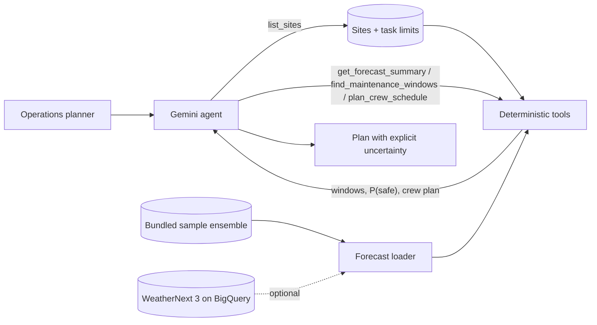

# weathernext-forecast-agent

**Plan wind-turbine maintenance from WeatherNext ensemble forecasts, with the
probability that each work window stays safe.**

Wind-farm maintenance is limited by weather. A main-component crane lift
(blade, hub or gearbox exchange) needs a long, calm, dry daylight window; blade
repairs need dry air for resin to cure; even routine nacelle service has a
wind limit for climbing. Mobilizing a large crane and crew for a window that does not
hold is expensive, and a forecast that "looks fine" on the median can still
have a one-in-three chance of wind above the lift limit.

This recipe gives an operations planner an ADK agent that answers questions
like *"We have 2 crane crews this week. Where should they go, when, and how
sure are we?"*, grounded in a **probabilistic (ensemble) forecast** from
[WeatherNext](https://developers.google.com/weathernext). The agent never
computes weather numbers itself:

1. **Deterministic tools do the math** ([`app/analysis.py`](app/analysis.py)).
   For every candidate window they check each ensemble member against the
   task's hub-height wind, gust and precipitation limits for every hour, and
   report the fraction of members for which the whole window stays workable.
2. **Limits live in config** ([`app/config.py`](app/config.py)): per task type,
   overridable with `TASK_LIMITS_JSON` so you can paste in the limits from
   your own lift plans and OEM manuals.
3. **Gemini plans and explains**: it picks the tools, compares sites,
   recommends a primary and backup window, and states the uncertainty
   (probability, members in support, and whether wind or rain is the risk).



## Real-world scenario

An operations planner for a portfolio of four wind farms (Texas Panhandle,
Scottish Highlands, northern Germany and a North Sea offshore site) has to
place two crane crews for blade exchanges in the next five days. They get:

- **A ranked list of windows per site** in local time, each with
  `probability_safe`, the number of ensemble members that support it, and what
  makes the failing members fail (wind/gust or precipitation).
- **A crew plan across sites**: one job per site, crews kept apart by a travel
  buffer, only windows at or above the task's go threshold, and the expected
  number of jobs that will complete.
- **A plain-language recommendation** with a backup, and a clear statement
  when no window is good enough, rather than a single deterministic "go".

Task limits shipped with the recipe (illustrative planning values, not OEM or
regulatory limits):

| Task type | Hub wind | Gust | Rain (1 h) | Hours | Go threshold |
| --- | --- | --- | --- | --- | --- |
| `main_component_lift` | ≤ 10 m/s | ≤ 14 m/s | ≤ 0.5 mm | 8, daylight | 80% |
| `blade_repair` | ≤ 12 m/s | ≤ 15 m/s | ≤ 0.1 mm | 6, daylight | 70% |
| `nacelle_service` | ≤ 18 m/s | ≤ 22 m/s | ≤ 2.0 mm | 4, daylight | 70% |

"Daylight" means 07:00–19:00 site local time. Wind is moved from 100 m to each
site's hub height with a power-law shear profile (`SHEAR_EXPONENT`, default
0.14), and gusts are estimated as `GUST_FACTOR` (default 1.35) times the
hub-height mean wind, because WeatherNext does not publish a gust variable.

### Example run

One live run with `MODEL_NAME=gemini-3.7-flash` on the bundled sample
(forecast init 2026-10-12 00:00 UTC, 32 members), prompt: *"We have 2 crane
crews available this week for main component lifts (blade exchanges). Which
sites should they go to and when? Give me the probability that each window
stays workable and a backup option."*

The agent made 6 tool calls (`list_sites`, `plan_crew_schedule`, then
`find_maintenance_windows` for each of the 4 sites) and answered in 27.2 s.
Every number below comes from the tools:

| Site | Best 8-hour lift window (local) | P(safe) | Members safe | Main risk |
| --- | --- | --- | --- | --- |
| Prairie Ridge | Tue 13 Oct 08:00–16:00 | 100% | 32/32 | none |
| Prairie Ridge (backup) | Wed 14 Oct 07:00–15:00 | 93.8% | 30/32 | wind/gust |
| Elbe Marsh | Tue 13 Oct 10:00–18:00 | 65.6% | 21/32 | wind/gust |
| Highland Moor | Wed 14 Oct 10:00–18:00 | 28.1% | 9/32 | wind/gust |
| Dogger Offshore | Fri 16 Oct 07:00–15:00 | 28.1% | 9/32 | wind/gust |

The crew plan assigned crew 1 to Prairie Ridge on Tuesday (expected completed
jobs: 1.0) and left crew 2 unassigned, because no other site reached the 80%
go threshold. The agent recommended either a second Prairie Ridge lift on the
Wednesday backup window, or holding the second crew for a newer forecast or a
less wind-sensitive task (blade repair, nacelle service), and closed with the
decision-support reminder.

## What you will learn

- Grounding an agent in **probabilistic data**: probabilities come from
  counting ensemble members, so the agent can say "30 of 32 members" instead
  of guessing.
- Keeping **domain rules in a config module** that operators can override
  without touching code.
- Building tools that accept **two data shapes** (member-level ensembles and
  precomputed quantiles) behind one interface, and being explicit about what
  each can and cannot tell you.

## Requirements

Before you begin, ensure you have:
- **uv**: Python package manager - [Install](https://docs.astral.sh/uv/getting-started/installation/)
- Access to Gemini through Vertex AI or a Google AI Studio API key.
- Optional: WeatherNext data access and a Google Cloud project with BigQuery
  (see [Data access](#data-access)).

## Setup

> **Note**: All commands below must be run from the recipe root directory (`contrib/python/weathernext-forecast-agent/`).

1. Install required packages:
   ```bash
   uv sync
   ```

2. Set up environment variables. Copy `.env.example` to `.env` and configure
   either Vertex AI (`GOOGLE_CLOUD_PROJECT`, `GOOGLE_GENAI_USE_VERTEXAI=True`)
   or `GEMINI_API_KEY`:
   ```bash
   cp .env.example .env
   ```

   | Variable | Default | Purpose |
   | --- | --- | --- |
   | `MODEL_NAME` | `gemini-3.7-flash` | Model that plans and explains |
   | `WEATHERNEXT_SOURCE` | `sample` | `sample` or `bigquery` |
   | `WEATHERNEXT_BQ_TABLE` | — | `project.dataset.weathernext_3_0_0_0p1deg` |
   | `WEATHERNEXT_BQ_PROJECT` | client default | Project billed for queries |
   | `WEATHERNEXT_INIT_TIME` | latest 6-hourly init | Pin a forecast run |
   | `WEATHERNEXT_MAX_HOURS` | `120` | Lead hours to load (≤ 360) |
   | `WEATHERNEXT_BQ_TIMEOUT_SECONDS` | `60` | BigQuery query timeout (client and server) |
   | `SITES_JSON` | bundled `app/data/sites.json` | Your wind farms |
   | `SAMPLE_FORECAST_JSON` | bundled sample | Your own member-level ensemble |
   | `TASK_LIMITS_JSON` | — | Override or add task limits |
   | `GUST_FACTOR` | `1.35` | Gust / hub-height mean wind |
   | `SHEAR_EXPONENT` | `0.14` | 100 m → hub height wind shear |

## Run

Start the agent in the terminal:

```bash
uv run adk run app
# > We have 2 crane crews this week for blade exchanges. Where and when?
# > When can we do blade repairs at Elbe Marsh, and how confident are you?
```

Or start the local web server and open the ADK dev UI:

```bash
uv run uvicorn app.fast_api_app:app --reload
```

## Data access

### Bundled sample (default)

`app/data/sample_forecast.json` is a **synthetic** 32-member hourly ensemble
for four illustrative sites over 120 hours, shaped like WeatherNext 3 0.1°
surface output (`wind_speed_100m` in m/s, `total_precipitation_1hr` in mm).
It is generated deterministically to include realistic features (frontal
passages, timing spread that grows with lead time, a diurnal low-level jet),
but it is **not real WeatherNext data**. The sites in
`app/data/sites.json` are representative locations, not specific farms.

To use your own member-level ensemble (for example extracted from
WeatherNext's raw 64-member Zarr store), write a file in the same format and
point `SAMPLE_FORECAST_JSON` and `SITES_JSON` at it.

### WeatherNext 3 via BigQuery (optional)

WeatherNext 3 forecasts are published on Google Cloud Storage (Zarr), Earth
Engine and BigQuery
([quick start](https://developers.google.com/weathernext/guides/access-forecast)).
Access is by request: submit the
[WeatherNext Data Request form](https://docs.google.com/forms/d/e/1FAIpQLSeCf1JY8G78UDWzbm0ly9kJxfSjUIJT5WyMR_HiNqCm-IHIBg/viewform);
one approval covers all three surfaces. Then subscribe to the
[WeatherNext 3 BigQuery Analytics Hub listing](https://developers.google.com/weathernext/guides/bigquery),
which links the tables into a dataset in your project, and set:

```bash
WEATHERNEXT_SOURCE=bigquery
WEATHERNEXT_BQ_TABLE=your-project.your_dataset.weathernext_3_0_0_0p1deg
```

The loader ([`app/forecast.py`](app/forecast.py)) follows the documented
schema: rows partitioned by `init_time`, a `geography_polygon` per 0.1° cell,
and a repeated `forecast` record with `time`, `hours` and
`<variable>_<statistic>` columns. It selects the latest 6-hourly init in the
last two days (or `WEATHERNEXT_INIT_TIME`), filters on the partition column and
the cell containing each site, reads `wind_speed_100m_{p10,p25,p50,p75,p90}`
and `total_precipitation_1hr_{p10,…,p90}`, and converts precipitation from
metres to millimetres. Each query is bounded by `WEATHERNEXT_BQ_TIMEOUT_SECONDS` (client wait and BigQuery job timeout), and results are cached per site per process.

> [!IMPORTANT]
> The BigQuery listing publishes **precomputed ensemble statistics** (mean
> and percentiles), not individual members. From quantiles alone the
> probability that a whole multi-hour window is safe cannot be computed
> exactly, so in this mode the tools report `probability_safe` (the smallest
> per-hour, per-variable marginal probability: exact only if the conditions
> are perfectly correlated, otherwise optimistic) **and**
> `probability_safe_lower_bound` (the Fréchet bound, valid for any
> correlation). Use member-level data from the
> [Zarr full-ensemble store](https://developers.google.com/weathernext/guides/gcs)
> for exact joint probabilities.

The table and column names were taken from the WeatherNext documentation; the
BigQuery path is covered by unit tests with a fake client and has not been run
against the live listing by the author. Check the schema of your linked table
(`SELECT * FROM ... LIMIT 1`) before relying on it.

**Terms**: real-time WeatherNext data (less than 1 hour old and the future) is
governed by the
[GDM Real-Time Weather Forecasting Experimental Data Terms of Use](https://storage.googleapis.com/weathernext-public/terms-of-use.pdf);
historical data (1 hour old or more) is licensed under CC BY 4.0. See
[Terms of Service and Disclaimers](https://developers.google.com/weathernext/guides/disclaimers).

## Deploy and use it where your team works

The recipe ships a `Dockerfile` and serves the standard ADK FastAPI app, so
it runs on Cloud Run:

```bash
gcloud run deploy weathernext-forecast-agent --source . --region us-central1 \
  --set-env-vars MODEL_NAME=gemini-3.7-flash,GOOGLE_GENAI_USE_VERTEXAI=True
```

For live data, add `WEATHERNEXT_SOURCE=bigquery` and `WEATHERNEXT_BQ_TABLE`,
and grant the service account `roles/bigquery.jobUser` on the billing project
and `roles/bigquery.dataViewer` on the linked dataset.

To bring it to your operations team, make the agent available in your Gemini
Enterprise app (the recipe includes an Agent Engine adapter in
`app/app_utils/`) and expose it in Google Chat by following
[Build a Google Chat app with a Gemini Enterprise AI agent](https://developers.google.com/workspace/chat/quickstart-ge-agent).
Planners can then ask for this week's lift windows from the Chat space they
already use for daily operations.

## Safety and limitations

- **Decision support only.** The agent recommends; it does not authorize
  work. The site's lift plan, the crane and turbine manufacturers' limits,
  on-site wind measurements, and the person in charge of the work have the
  final say. Always follow your site safety procedures.
- **Forecasts are probabilistic.** A 90% window still fails one time in ten.
  Probabilities come from the ensemble and are only as reliable as its
  calibration; re-check with each new forecast run, and against observations
  on the day.
- **Not modelled:** lightning and convective risk (WeatherNext 3 does not
  publish a lightning variable; precipitation is only a proxy), measured
  gusts (estimated from a gust factor), temperature limits, icing, visibility,
  and sea state. Offshore access by vessel depends on significant wave height,
  which this recipe does not use; add your metocean source before using it
  for offshore transfers.
- **Illustrative defaults.** Task limits, gust factor and shear exponent are
  placeholders. Replace them with values from your own procedures and site
  data.
- WeatherNext predictions are provided "as is" and are not official weather
  warnings; defer to local authorities for severe weather.

## Running Tests

The unit tests cover the loaders (including the BigQuery path with a fake
client), percentile and quantile math, window search edge cases, crew
planning and the tools, and do not call a model:

```bash
uv run pytest
```

Integration tests call Gemini and need credentials:

```bash
uv run pytest tests/integration
```

## Commands

| Command | Description |
| ------- | ----------- |
| `uv run adk run app` | Run the agent in interactive CLI mode |
| `uv run uvicorn app.fast_api_app:app --reload` | Start the local FastAPI development server |
| `uv run pytest` | Run the unit and runnability tests |
