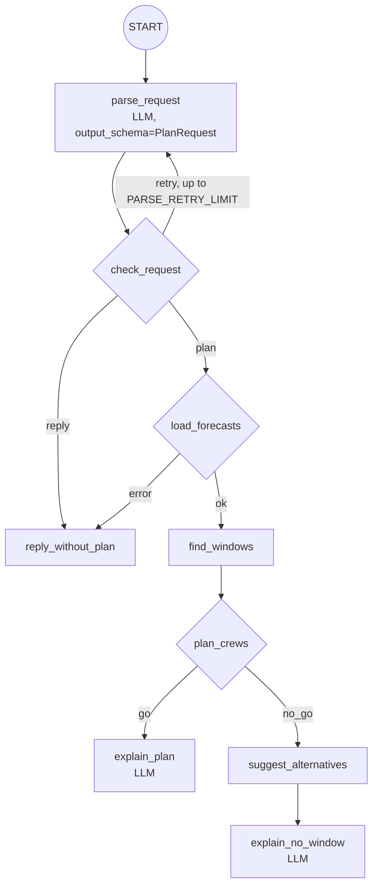

# weathernext-forecast-agent

**Plan wind-turbine maintenance from ensemble weather forecasts, with the
probability that each work window stays safe.**

Wind-farm maintenance is limited by weather. A main-component crane lift
(blade, hub or gearbox exchange) needs a long, calm, dry daylight window; blade
repairs need dry air for resin to cure; even routine nacelle service has a wind
limit for climbing. Mobilizing a large crane and crew for a window that does not
hold is expensive, and a day that "looks fine" on the ensemble median can still
fail in a third of the members (see Wednesday at Whitelee below).

This recipe gives an operations planner an ADK 2.0 agent that answers
questions like *"Which day this week can the crane lift at Whitelee go ahead,
and how sure are we?"* from **raw ensemble members**: it counts the members in
which every step of the job stays within the task's wind, gust and rain limits.
The production data source is the
[WeatherNext 3](https://developers.google.com/weathernext) 64-member ensemble
on Google Cloud Storage; with no credentials at all it runs on **ECMWF AIFS
ENS** (51 members) from [dynamical.org](https://dynamical.org/catalog/ecmwf-aifs-ens-forecast/),
either live or from a bundled real snapshot. Both go through the same analysis
code. The model never computes weather numbers itself.

## The decision this recipe makes

> **Blade exchange at Whitelee Wind Farm, Scotland, Tuesday 20 – Saturday 24
> October 2026.** A damaged blade needs a main-crane lift: 8 consecutive
> daylight hours with hub-height wind ≤ 10 m/s, gusts ≤ 14 m/s and rain
> ≤ 0.5 mm/h. Go if the whole window holds in at least 80% of ensemble
> members. The same contractor also has to place **two crane crews across
> three farms** (Whitelee, Clyde, Black Law) that week.

The answer from the bundled forecast (ECMWF AIFS ENS, run 2026-10-20 06:00
UTC, 51 members, 6-hourly steps):

| Whitelee, 8-hour lift window (BST) | P(safe) | Members safe | Exceedance at any step |
| --- | --- | --- | --- |
| **Thu 22 Oct 07:00–15:00 — go** | **100%** | 51/51 | none |
| Wed 21 Oct 07:00–15:00 — no-go | 66.7% | 34/51 | rain 33.3%, wind 2.0% |
| Tue 20 Oct 07:00–15:00 — no-go | 37.3% | 19/51 | rain 62.7% |
| Fri 23 Oct 07:00–15:00 — no-go | 21.6% | 11/51 | rain 78.4%, wind 23.5% |
| Sat 24 Oct 07:00–15:00 — no-go | 3.9% | 2/51 | rain 96.1%, wind 80.4% |

The weekend is out: across members, the daily maximum hub-height wind at
Whitelee rises from a p90 of 7.0 m/s on Thursday to 16.2 m/s on Saturday,
with 82.4% of members above the lift limit at some step.

For the two-crew question, Thursday is also the best lift day at Black Law
(100%, 51/51) and Clyde (98.0%, 50/51), and two crews cannot cover three farms
in one day. No other day reaches the 80% threshold at any farm (the next best
is Clyde on Wednesday, 68.6%), so the planner sends crew 1 to Black Law and
crew 2 to Whitelee on Thursday and leaves Clyde unassigned ("no crew free for
any qualifying window"): expected completed lifts 2.0. If the lift must happen
in the next two days, there is no go window: the best is Wednesday at 66.7%,
and the agent offers nacelle service (100%, 51/51) as work the crew can do
instead.

### Sites

| Site | Coordinates (WGS 84) | AIFS ENS grid point | Hub height used | Source |
| --- | --- | --- | --- | --- |
| Whitelee Wind Farm, East Renfrewshire | 55.6728, −4.2856 | 55.75, −4.25 | 65 m | [Wikipedia](https://en.wikipedia.org/wiki/Whitelee_Wind_Farm) (coordinates, hub height) |
| Clyde Wind Farm, South Lanarkshire | 55.4672, −3.6544 | 55.50, −3.75 | 80 m (assumed) | [Wikipedia](https://en.wikipedia.org/wiki/Clyde_Wind_Farm) (coordinates) |
| Black Law Wind Farm, South Lanarkshire | 55.7669, −3.7389 | 55.75, −3.75 | 80 m (assumed) | [Wikipedia](https://en.wikipedia.org/wiki/Black_Law_Wind_Farm) (coordinates) |

Coordinates were retrieved on 2026-10-19. Hub height is published in the
cited source for Whitelee only; replace the assumed values with the
operator's. Sites carry an IANA time zone (`Europe/London`), so working hours
and calendar days follow BST/GMT changes (BST ended on 25 October 2026). The
recipe has no affiliation with the owners or operators of these farms.

## Architecture

### Data: one dataset contract, three sources

The design follows the WeatherNext team's forecast dataset contract and
ensemble-analysis semantics. Each source is a small adapter in
[`app/forecast.py`](app/forecast.py) that returns an in-memory xarray Dataset
of **raw members** for one site; [`app/contract.py`](app/contract.py) checks
the contract and [`app/analysis.py`](app/analysis.py) only ever reads it
through the contract:

- variables are found by CF `standard_name` (`wind_speed`,
  `precipitation_flux` or `lwe_thickness_of_precipitation_amount`), never by
  name, and converted to m/s, mm/h or mm from their `units`; accumulations
  are never turned into rates or the other way round;
- each variable has a `step_type` (`instant`, `avg`, `accum`, ...) and, for
  accumulations, a `step_period`; `avg` intervals come from the `lead_time`
  spacing, which may be uneven;
- members sit on the dimension whose coordinate has `standard_name:
  realization`; variables tagged with a `statistic` (mean, p90, ...) are
  rejected, because window probabilities need members;
- valid time is `init_time + lead_time`; latitude and longitude are found by
  `standard_name`.

| `FORECAST_SOURCE` | Dataset | Access | Steps | Wind | Precipitation |
| --- | --- | --- | --- | --- | --- |
| `weathernext_3` | WeatherNext 3, 64 members (`sample`) | Allowlisted Google account, ADC | hourly | 100 m speed derived per member from `u`/`v_component_of_wind_100m` | `imerg_tp_1hr`: 1-hour accumulation (m), `accum`, `PT1H` |
| `aifs_ens` | ECMWF AIFS ENS, 51 members (`ensemble_member`) | Public, anonymous Icechunk over HTTPS | 6-hourly | 100 m speed derived per member from `wind_u_100m`/`wind_v_100m` | `precipitation_surface`: mean rate over the previous step (kg m-2 s-1), `avg` |
| `snapshot` (default) | Bundled point subset of AIFS ENS | none | 6-hourly | as `aifs_ens` | as `aifs_ens` |

Neither dataset publishes a **wind gust** variable, so gusts are estimated as
`GUST_FACTOR` (default 1.35) times the hub-height mean wind, and every answer
labels them as an estimate. Wind is moved from the dataset's 100 m (recorded on
the variable) to each site's hub height with a power-law shear profile
(`SHEAR_EXPONENT`, default 0.14).

### Probabilities

The window probability uses the semantics and terms of the WeatherNext
ensemble-analysis skill:

- a **step condition** ("hub wind ≤ 10 m/s") is evaluated for every member at
  every step; a missing value never satisfies it, and steps missing for all
  members are skipped;
- the **joint condition** "hub wind ≤ limit AND precipitation ≤ limit" is
  ANDed within each member, so the hour-to-hour and wind-to-rain correlation
  of each member is kept;
- **P(safe) = `prob_all_steps`** of the joint condition: the fraction of
  members in which it holds at *every* step of the window (temporal
  persistence);
- for each limit, the answer also reports the exceedance
  **`prob_any_step`** and the **`peak_step_prob`** (the highest single-step
  probability) with its local valid time.

Which steps belong to a window depends on step semantics: instantaneous wind
uses the steps that bracket the window (the last step at or before the start
through the first step at or after the end), and interval variables use every
step whose interval overlaps it. With hourly WeatherNext 3 data that is every
hour of the job. With 6-hourly AIFS ENS an 8-hour window rests on three wind
samples and two 6-hour rain means, and the 6-hour **mean** rain rate is
compared with the hourly limit; windows report this as `step_hours: 6`, and the
explanation says so.

When no window qualifies, the agent adds a **daily outlook** per site in the
style of the ensemble-analysis `--group-by-day` output: complete local days
only (coverage of 23–25 hours around DST changes), interval steps ending at
local 00:00 counted on the previous day, each member's daily maximum hub wind
and rain total summarized as p10/p50/p90, and the probability of exceeding the
task's limits at any step. Following the WeatherNext daily-summary rules, a
note flags that maxima of 6-hourly samples understate the true peak, and rain
totals are left out when 6-hour intervals do not line up with local midnight
(as in BST).

### The ADK 2.0 graph workflow

The root of the app is an ADK 2.0 `Workflow`
([`app/agent.py`](app/agent.py)). Deterministic steps are **function nodes**;
only three nodes call Gemini, all as `Agent(mode="single_turn")`:



| Node | Kind | What it does |
| --- | --- | --- |
| `parse_request` | LLM (`single_turn`, Pydantic `output_schema`) | Turns the planner's message (and follow-ups) into `PlanRequest`: task type, sites, crews, horizon, hours |
| `check_request` | function, routes | Validates ids and numbers; sends errors back to the parser once (`retry`, bounded by `PARSE_RETRY_LIMIT`), else `plan` or `reply` |
| `reply_without_plan` | function | Deterministic help text: sites, task limits, example questions, or the validation/data error |
| `load_forecasts` | function, routes | Loads every site's members and checks the dataset contract; `error` if access fails (for example not on the WeatherNext allowlist) |
| `find_windows` | function | Scores every allowed window per site: `prob_all_steps` of the joint condition, exceedance and peak-step probabilities |
| `plan_crews` | function, routes | Assigns crews (one job per site, travel buffer, go threshold); `go` if any crew is assigned, else `no_go` |
| `suggest_alternatives` | function | For `no_go`: best window for every other task type, plus the daily outlook per site |
| `explain_plan` / `explain_no_window` | LLM (`single_turn`, `include_contents="none"`) | Narrate only the numbers in their JSON input, with local times, members in support, the main risk and the dataset attribution |

Task limits live in config ([`app/config.py`](app/config.py)), overridable with
`TASK_LIMITS_JSON` so you can paste in the limits from your own lift plans and
OEM manuals:

| Task type | Hub wind | Gust (estimated) | Rain | Hours | Go threshold |
| --- | --- | --- | --- | --- | --- |
| `main_component_lift` | ≤ 10 m/s | ≤ 14 m/s | ≤ 0.5 mm/h | 8, daylight | 80% |
| `blade_repair` | ≤ 12 m/s | ≤ 15 m/s | ≤ 0.1 mm/h | 6, daylight | 70% |
| `nacelle_service` | ≤ 18 m/s | ≤ 22 m/s | ≤ 2.0 mm/h | 4, daylight | 70% |

These are illustrative planning values, not OEM or regulatory limits.
"Daylight" means 07:00–19:00 site local time. The rain limit is compared with
each step's rate, or with a 1-hour accumulation as mm per hour.

There is deliberately **no human-in-the-loop `RequestInput` step**: the
workflow only recommends, it never books crews or changes anything, and a
paused task would break the single request/response chat turn that the Gemini
agent and Gemini Enterprise use over A2A. Approval stays with the people on
site (see [Safety and limitations](#safety-and-limitations)).

### Example run

Live run on 2026-11-03 with `MODEL_NAME=gemini-3.7-flash` on the bundled
AIFS ENS snapshot, three turns in one session:

1. *"We need to swap a damaged blade at Whitelee this week (Tue 20 to Sat 24
   October). Which day can the main crane lift go ahead, and how sure are
   you?"* Trace: `parse_request` → `check_request` (`plan`) →
   `load_forecasts` (`ok`) → `find_windows` → `plan_crews` (`go`) →
   `explain_plan`; 2 model calls, 9.2 s. Answer: crew 1 to Whitelee on
   **Thursday 22 Oct 07:00–15:00, 100% (51 of 51 members)**, no member
   exceeding either limit; backup Wednesday 07:00–15:00 at 66.7% (34 of 51),
   where rain exceeds the limit at some step in 33.3% of members (peak 21.6%
   for 13:00–19:00); the 6-hour step, the estimated gusts, the run and the
   dynamical.org attribution are stated; decision-support line at the end.
2. *"We have 2 crane crews for blade exchanges at Whitelee, Clyde and Black
   Law this week. Which farm when?"* Same route, 20.1 s: Black Law and
   Whitelee on Thursday (100% each), Clyde unassigned because no crew is free
   for its Thursday window (98%, 50 of 51).
3. *"What if the Whitelee lift has to happen in the next two days?"* Route
   `plan_crews` (`no_go`) → `suggest_alternatives` → `explain_no_window`,
   17.9 s: no go window (best Wednesday, 66.7%), do not proceed; nacelle
   service on Tuesday 07:00–11:00 (100%) as alternative work; the daily
   outlook shows rain over the limit at some step in 64.7% of members on
   Wednesday.

## What you will learn

- Building an **ADK 2.0 graph `Workflow`**: function nodes for the math,
  `single_turn` LLM nodes with a Pydantic `output_schema`, conditional routes
  (`Event(route=...)` with dict edges) and a bounded retry loop back to the
  parser.
- Reading **WeatherNext 3 ensemble members from Zarr** on Cloud Storage, and a
  public ensemble (ECMWF AIFS ENS) through the same **dataset contract**, so
  the agent's analysis never depends on one dataset's variable names.
- Grounding an agent in **probabilistic data**: probabilities come from
  counting members over the whole window, so the agent can say "34 of 51
  members" instead of guessing.
- Serving the agent over **A2A JSON-RPC and HTTP+JSON**, the bindings Gemini
  Enterprise and the Gemini agent (via Agent Registry) use.

## Requirements

Before you begin, ensure you have:
- **uv**: Python package manager - [Install](https://docs.astral.sh/uv/getting-started/installation/)
- Access to Gemini through Vertex AI or a Google AI Studio API key.
- Optional: Python 3.12+ for live AIFS ENS (`icechunk` 2 needs it; the
  container image uses 3.12), and WeatherNext data access for WeatherNext 3
  (see [Data access](#data-access)).

## Setup

> **Note**: All commands below must be run from the recipe root directory (`contrib/python/weathernext-forecast-agent/`).

1. Install required packages:
   ```bash
   uv sync
   ```

2. Set up environment variables. Copy `.env.example` to `.env` and configure
   either Vertex AI (`GOOGLE_CLOUD_PROJECT`, `GOOGLE_GENAI_USE_VERTEXAI=True`)
   or `GEMINI_API_KEY`:
   ```bash
   cp .env.example .env
   ```

   | Variable | Default | Purpose |
   | --- | --- | --- |
   | `MODEL_NAME` | `gemini-3.7-flash` | Model for the parse and explain nodes |
   | `PARSE_RETRY_LIMIT` | `1` | Times an invalid parsed request goes back to the parser |
   | `FORECAST_SOURCE` | `snapshot` | `snapshot`, `aifs_ens` or `weathernext_3` |
   | `FORECAST_INIT_TIME` | newest complete 6-hourly init | Pin a forecast run (live sources) |
   | `FORECAST_MAX_LEAD_HOURS` | `168` | Lead hours to load (≤ 360) |
   | `AIFS_ENS_ICECHUNK_URL` | dynamical.org store | ECMWF AIFS ENS Icechunk repository |
   | `WEATHERNEXT_ZARR_URI` | public full-ensemble folder | WeatherNext 3 ensemble Zarr (folder of per-init stores, or one `.zarr`) |
   | `WEATHERNEXT_BILLING_PROJECT` | — | Project billed for Requester Pays reads |
   | `SITES_JSON` | bundled `app/data/sites.json` | Your wind farms |
   | `FORECAST_SNAPSHOT_JSON` | bundled snapshot | Your own point snapshot |
   | `TASK_LIMITS_JSON` | — | Override or add task limits |
   | `GUST_FACTOR` | `1.35` | Gust / hub-height mean wind |
   | `SHEAR_EXPONENT` | `0.14` | Dataset height → hub height wind shear |

## Run

Start the agent in the terminal:

```bash
uv run adk run app
# > Which day this week can the crane lift at Whitelee go ahead?
# > We have 2 crane crews for blade exchanges at Whitelee, Clyde and Black Law. Which farm when?
# > What about blade repair instead?
```

Or start the local web server and open the ADK dev UI:

```bash
uv run uvicorn app.fast_api_app:app --reload
```

## Data access

### Production: WeatherNext 3 ensemble members on Cloud Storage

WeatherNext 3 forecasts are published as Zarr on
[Google Cloud Storage](https://developers.google.com/weathernext/guides/gcs).
Access is restricted to approved Google accounts and approval is manual:
submit the
[WeatherNext Data Request form](https://docs.google.com/forms/d/e/1FAIpQLSeCf1JY8G78UDWzbm0ly9kJxfSjUIJT5WyMR_HiNqCm-IHIBg/viewform)
(see [Request data access](https://developers.google.com/weathernext/guides/access-forecast#step_1_request_data_access));
reading fails until it is granted. Then sign in with Application Default
Credentials and check access before planning:

```bash
gcloud auth application-default login
uv run python -m app.weathernext_access
```

The check lists one object of `WEATHERNEXT_ZARR_URI` with your credentials
and tells you what to do on a missing login, an expired login (401), an
account that is not on the allowlist (403, with the request form) or a
Requester Pays bucket without `WEATHERNEXT_BILLING_PROJECT`. The
`weathernext_3` source runs the same check once before its first read and
stops with that message instead of retrying. Then set:

```bash
FORECAST_SOURCE=weathernext_3
# The public full-ensemble layout (one store per init) is the default:
WEATHERNEXT_ZARR_URI=gs://weathernext3_spatial/weathernext_3_0_0/zarr/2026_to_present
WEATHERNEXT_BILLING_PROJECT=your-project   # the full-ensemble bucket is Requester Pays
```

The adapter picks the newest 6-hourly run folder (`YYYYMMDD_HHhr_XX_preds`;
hourly interim runs only reach 48 hours), opens its `predictions.zarr` with
[obstore](https://developmentseed.org/obstore/) and Zarr, flattens the
6-hourly `lead_time` × `lead_subtime` layout into hourly steps, selects the
nearest 0.1° grid point (`lat_0p1`, `lon_0p1` in 0–360°) and reads the 100 m
wind components and `imerg_tp_1hr`, the precipitation variable the WeatherNext
skills recommend. If you have been given a single rechunked `.zarr` store
instead (all inits on one axis, optionally with a `res_0p1` group, members on
`sample`), point `WEATHERNEXT_ZARR_URI` at it: the adapter then takes the
newest processed 6-hourly init.

**Terms**: real-time WeatherNext data (less than 1 hour old and the future) is
governed by the
[GDM Real-Time Weather Forecasting Experimental Data Terms of Use](https://storage.googleapis.com/weathernext-public/terms-of-use.pdf);
historical data (1 hour old or more) is licensed under CC BY 4.0. See
[Terms of Service and Disclaimers](https://developers.google.com/weathernext/guides/disclaimers).
WeatherNext forecasts are experimental, provided as-is and are not official
weather warnings.

> [!NOTE]
> The recipe no longer reads WeatherNext from BigQuery. The BigQuery listing
> publishes precomputed per-hour statistics (mean and percentiles), from
> which the probability that a whole multi-hour window is safe cannot be
> computed; the members on Cloud Storage give it exactly. Use
> [WeatherNext on BigQuery](https://developers.google.com/weathernext/guides/bigquery)
> for dashboards and summary statistics.

### No credentials: ECMWF AIFS ENS from dynamical.org

[dynamical.org](https://dynamical.org/catalog/ecmwf-aifs-ens-forecast/) hosts
an archive of ECMWF AIFS ENS forecasts (51 members, 0.25°, 6-hourly steps to
15 days, a run every 6 hours since July 2025) as a public Icechunk repository
on AWS Open Data. `FORECAST_SOURCE=aifs_ens` opens it anonymously over HTTPS
with `icechunk` and xarray, walks back from the newest run (up to 8) to the
first one whose last step is complete at the site, and reads the 100 m wind
components and `precipitation_surface` at the nearest grid point. The store
already carries the contract's CF attributes.

The **bundled snapshot** (`app/data/forecast_snapshot.json`, 96 kB) is a real
point subset of that store, read by the same adapter:

| | |
| --- | --- |
| Model | ECMWF AIFS ENS, 51 members |
| Run | 2026-10-20 06:00 UTC, leads 0–168 h every 6 h |
| Source | `https://dynamical-ecmwf-aifs-ens.s3.us-west-2.amazonaws.com/ecmwf-aifs-ens-forecast/v0.1.0.icechunk` (dataset version 0.1.0), retrieved 2026-11-03 |
| Variables | `wind_u_100m`, `wind_v_100m` (m s-1, instant), `precipitation_surface` (kg m-2 s-1, mean over the previous 6 h; missing at lead 0) |
| Grid | Nearest 0.25° grid point to each site (see Sites) |
| Changes | Point selection only; native names and attributes kept; wind rounded to 0.001 m s-1, precipitation to 4 significant digits |
| Licence | [CC BY 4.0](https://creativecommons.org/licenses/by/4.0/) and the [ECMWF Terms of Use](https://apps.ecmwf.int/datasets/licences/general/) |

ECMWF AIFS ENS forecast data processed by dynamical.org from ECMWF Open Data.
The same provenance is stored in the file. It is a single past run: do not use
it to plan real work.

To use your own sites, point `SITES_JSON` at a file like
`app/data/sites.json`; with `aifs_ens` or `weathernext_3` the forecasts are
read for them live.

## Deploy and use it where your team works

The recipe ships a `Dockerfile` (Python 3.12, non-root) and serves the
standard ADK FastAPI app, so it runs on Cloud Run:

```bash
gcloud run deploy weathernext-forecast-agent --source . --region us-central1 \
  --set-env-vars MODEL_NAME=gemini-3.7-flash,GOOGLE_GENAI_USE_VERTEXAI=True
```

For live data add `FORECAST_SOURCE=aifs_ens` (no credentials), or
`FORECAST_SOURCE=weathernext_3` with `WEATHERNEXT_BILLING_PROJECT`, running the
service as a service account that is on the WeatherNext allowlist and has
`roles/serviceusage.serviceUsageConsumer` on the billing project. Set
`APP_URL` to the service URL so the A2A agent card points at it.

### A2A endpoints

All under `APP_URL` + `/a2a/app`:

| Binding | Version | Routes |
| --- | --- | --- |
| JSON-RPC | 1.0 and 0.3 | `POST /a2a/app` (`SendMessage`, `message/send`, ...) |
| HTTP+JSON | 0.3 | `GET /a2a/app/v1/card`, `POST /a2a/app/v1/message:send`, `POST /a2a/app/v1/message:stream` |
| HTTP+JSON | 1.0 | `POST /a2a/app/message:send`, `POST /a2a/app/message:stream`, ... |
| Agent card | — | `GET /a2a/app/.well-known/agent-card.json` (lists all four interfaces) |

A v0.3 HTTP+JSON `message:send` without a `configuration` waits for the
answer (as JSON-RPC does); send `"configuration": {"blocking": false}` to get
the task back immediately.

### Use it in the Gemini agent

The Gemini agent reaches third-party agents through
[Agent Registry](https://docs.cloud.google.com/gemini-enterprise-agent-platform/govern/agent-registry),
which invokes A2A agents over the **HTTP+JSON** binding (`GET /v1/card`,
`POST /v1/message:send` with `role: ROLE_USER`, `content[].text` and a unique
`messageId`).

1. Deploy to Cloud Run as above, with `APP_URL` set.
2. Register it as an A2A agent in Gemini Enterprise / Agent Registry by
   following
   [Register and manage A2A agents](https://docs.cloud.google.com/gemini/enterprise/docs/register-and-manage-an-a2a-agent)
   (it covers the Cloud Run invoker role for the Discovery Engine service
   agent and optional OAuth).
3. Call it from the Gemini agent, or programmatically through its registry
   endpoint, as described in
   [Call an agent using its registry A2A endpoint](https://docs.cloud.google.com/gemini/enterprise/docs/invoke-agent-a2a).
4. For Google Chat, follow
   [Build a Google Chat app with a Gemini Enterprise AI agent](https://developers.google.com/workspace/chat/quickstart-ge-agent).

Follow-up questions ("what about blade repair instead?") work because
`parse_request` reads the conversation.

## What was verified

No Google Cloud project, WeatherNext access, Agent Registry or Gemini
Enterprise tenant was available to the author, so:

- **WeatherNext 3 on Cloud Storage was not read.** The `weathernext_3`
  adapter, the run-folder selection, the `lead_subtime` flattening, the
  `res_0p1` fallback and the access check are covered by unit tests with fake
  stores and HTTP responses built from the public documentation; check them
  against the store you are given before relying on them.
- **ECMWF AIFS ENS was read live** from dynamical.org on 2026-11-03 with
  Python 3.12 and `icechunk` 2.3 (store attributes, latest-init walk-back,
  point extraction); that is how the bundled snapshot was made.
- Against the local server, `GET /a2a/app/v1/card` returns the v0.3 card
  (`protocolVersion` 0.3, `preferredTransport` HTTP+JSON, `url`, name,
  description, skills), and `POST /a2a/app/v1/message:send` with the request
  body from the Gemini agent docs returns `TASK_STATE_COMPLETED` with the
  workflow's answer as the task artifact. A JSON-RPC 0.3 `message/send` round
  trip and the Agent Engine adapter's `async_create_session` also succeed
  ([`tests/integration/test_a2a_e2e.py`](tests/integration/test_a2a_e2e.py)).
  Running a query through the Agent Engine adapter needs Vertex AI
  credentials, because that runtime forces `GOOGLE_GENAI_USE_VERTEXAI=1`. In
  the A2A task history the structured `parse_request` output appears as an
  intermediate agent message; the answer itself is the task artifact.

## Safety and limitations

- **Decision support only.** The agent recommends; it does not authorize
  work. The site's lift plan, the crane and turbine manufacturers' limits,
  on-site wind measurements, and the person in charge of the work have the
  final say. Always follow your site safety procedures.
- **Forecasts are probabilistic.** A 90% window still fails one time in ten.
  Probabilities come from the ensemble and are only as reliable as its
  calibration; re-check with each new forecast run, and against observations
  on the day. With 64 or 51 members, probabilities move in steps of about 2%.
- **Coarse steps.** With 6-hourly data (AIFS ENS) a window is judged on a few
  samples and rain on 6-hour means, so short wind or rain peaks between
  samples are missed. Hourly WeatherNext 3 data is better suited to go/no-go.
- **Not modelled:** lightning and convective risk (precipitation is only a
  proxy), forecast gusts (neither dataset publishes them; estimated from a
  gust factor), temperature limits, icing, visibility and sea state.
- **Illustrative defaults.** Task limits, gust factor, shear exponent and the
  assumed hub heights are placeholders. Replace them with values from your own
  procedures and site data.
- WeatherNext and ECMWF predictions are provided "as is" and are not official
  weather warnings; defer to local authorities for severe weather.

## Running Tests

The unit tests cover the dataset contract (CF unit conversion, discovery by
`standard_name`, rejection of reduced statistics), the three adapters with
fake stores, the access check, the probability semantics (all-steps
persistence, joint condition, missing values, peak step, bracketing of
6-hourly steps), the daily outlook (complete days, midnight rule, DST, rain
alignment), crew planning on the real snapshot, every function node, and the
workflow routes (`go`, `no_go`, help, bounded retry) with the model replaced
by a fake. They do not call a model or the network:

```bash
uv run pytest
```

Integration tests call Gemini and need credentials. `test_a2a_e2e.py` starts
the server and does the agent-card checks plus `message:send` round trips over
JSON-RPC 0.3 and HTTP+JSON:

```bash
uv run pytest tests/integration
```

## Commands

| Command | Description |
| ------- | ----------- |
| `uv run adk run app` | Run the agent in interactive CLI mode |
| `uv run uvicorn app.fast_api_app:app --reload` | Start the local FastAPI development server |
| `uv run python -m app.weathernext_access` | Check WeatherNext Cloud Storage access |
| `uv run pytest` | Run the unit and runnability tests |
