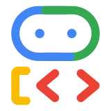

<div align="center">



<h1>ADK Voice Agent</h1>
<h3>A voice agent that runs coding agents for you.</h3>

</div>

> **Not an officially supported Google product.** Recipe code for demonstration only.

ADK Voice Agent is an [ADK](https://google.github.io/adk-docs/) recipe for a Gemini Live
voice agent that stays responsive while coding agents work in the background. Talk to it
from your phone or laptop: it starts coding threads at once (`start_thread`) using
Claude Code or the Antigravity CLI on your personal cloud computer, pauses before
actions that reach other people, and renders multi-turn thread chats and answer cards on
screen while keeping spoken replies short. Threads also work across Calendar, Gmail,
Drive, Docs, Sheets, Slides, and GitHub.

- **Study the recipe:** [`AGENTS.md`](AGENTS.md) maps each pattern to its implementation.
- **Run it:** [Quickstart](docs/quickstart.md).
- **Build your own:** [with a coding agent](#build-your-own-with-a-coding-agent).
- **Use it:** [Your computer](docs/computer.md), [Connected apps](docs/connected-apps.md).
- **How it works:** [Architecture](docs/architecture.md), [Security model](docs/security-model.md), [Configuration](docs/configuration.md), [Extending](docs/extending.md), [Evals](docs/evals.md).

## What it shows

**Voice that never waits on a tool**
- Bidirectional audio over ADK `run_live` with barge-in.
- Slow tools return at once and deliver results at the next pause with `WHEN_IDLE` ([`app/voice/non_blocking.py`](app/voice/non_blocking.py)); slow lookups emit one short status line.
- Thread milestones are announced once ([`app/voice/thread_updates.py`](app/voice/thread_updates.py)).
- Per-user choice of native Gemini Live audio or cascaded STT → LLM → TTS (`CascadeLive`) ([`app/voice/voice_mode.py`](app/voice/voice_mode.py)).

**Threads that act first**
- Threads start immediately (`start_thread`) with verbatim prompts, report findings via `update_user`, and pause (`awaiting_approval`) on gated calls ([`app/threads/`](app/threads/)).
- Steer running threads or follow up (`message_thread`), and pass context across threads (`share_context`).
- Detached runs and an append-only event log in SQLite or Postgres keep work durable across restarts.

**A computer per user**
- One `ComputerProvider` seam covering local directories, Docker, static URLs, or per-user GCE VMs with persistent disks ([`app/workers/providers/`](app/workers/providers/)). Idle VMs stop; voice sessions and warm hours pre-warm them.
- Git-backed folders (`code/<repo>`, `projects/<name>`, `scratch/`) with worktrees for concurrent writers and one commit per turn ([`app/workers/workspace.py`](app/workers/workspace.py)). Code branches push only on `publish_thread`.
- `claude` (`claude-opus-5-5`) and `antigravity` (`gemini-4-argon`) behind `CodingHarness` ([`app/workers/harnesses/`](app/workers/harnesses/)).

**Connected apps without tokens on the computer**
- Google and GitHub declared in [`config/integrations.yaml`](config/integrations.yaml), registered via `make onboard`, and connected per user via OAuth 2.0 ([`app/auth/`](app/auth/)).
- One MCP gateway attaches server-held tokens ([`app/api/mcp_gateway.py`](app/api/mcp_gateway.py)) and enforces `mcp_gates` from [`config/policy.yaml`](config/policy.yaml).

**One relationship, remembered**
- Home (`Needs you`, `Running`, `Recent`), project feeds, and multi-turn `ThreadView.tsx` chats synchronized with voice navigation ([`app/projects.py`](app/projects.py)).
- Per-user structured profiles and episode memories in Agent Engine Memory Bank ([`app/memory/`](app/memory/)).
- [A2UI v0.9](https://github.com/google/A2UI) context and answer cards ([`app/api/surfaces.py`](app/api/surfaces.py)).

## The stack

| Layer | What it uses |
|---|---|
| Voice agent | ADK `Runner.run_live()` with `LIVE_MODEL` |
| Server | FastAPI (`/run_live`, REST `/api/v1`, built UI) in one container |
| Coding agents | Claude Code, Antigravity CLI |
| Execution | Per-user [`sandbox/`](sandbox/) computer on GCE (or Docker, static URL, host) |
| Thread store | SQLAlchemy async on SQLite or Cloud SQL Postgres |
| Memory | Agent Engine Memory Bank ([`terraform/memory.tf`](terraform/memory.tf)) |
| UI | React, TypeScript, Vite |
| Deploy | Terraform + `agents-cli deploy` to Cloud Run behind IAP |

## Setup and run

### Prerequisites

- Python 3.11+, [`uv`](https://docs.astral.sh/uv/), Node.js 20+, `make`, Terraform, and `gcloud` (`gcloud auth login` and `gcloud auth application-default login`) on a billing-enabled project with `LIVE_MODEL` access.
- Model access for your chosen harness (`claude` via [Vertex AI Model Garden](https://console.cloud.google.com/vertex-ai/model-garden); `antigravity` via Vertex AI ADC).
- Optional: Docker (`make docker` and `docker` provider).

### Run

```bash
git clone --depth 1 --filter=blob:none --sparse https://github.com/google/adk-recipes.git
cd adk-recipes && git sparse-checkout set core/python/adk-voice-agent
cd core/python/adk-voice-agent

make onboard   # configures .env, OAuth apps, terraform, computer image, and Cloud Run deploy
```

Open the service URL, sign in, connect apps in **Settings → Apps**, and tap **Live**. For local hot reload against the same `.env`, run `make dev` (UI on <http://127.0.0.1:3000>, API on :8000). See [Quickstart](docs/quickstart.md).

> [!WARNING]
> **Billable resources.** `make onboard` provisions an always-on Cloud Run instance, Secret Manager secrets, Cloud SQL Postgres (`enable_cloud_sql`), Cloud NAT, and per-user GCE VMs (warm on weekdays 08:00–18:00 by default) with 50 GB disks, plus Gemini Live and harness token usage. Run `make destroy` when finished (`PURGE=1` also deletes user home disks); it deletes the computers and all Terraform resources, including the Agent Engine and every user's memories.

**IAP access.** `iap_users` in [`terraform/variables.tf`](terraform/variables.tf) defaults to `[]` (`grant_deployer_access = true` adds the deployer). Add users in `terraform/terraform.tfvars` (from [`terraform/prod.tfvars.example`](terraform/prod.tfvars.example)) and re-run `make deploy`.

### Try it

Tap **Live** and say *"Fix the failing test in voice-agent-playground"* or *"Start a project to sell my car."* To add your own repos, see [Your computer](docs/computer.md#add-a-repo).

## Build your own with a coding agent

Open this folder in Claude Code, Gemini CLI, or Antigravity:

- *"Read AGENTS.md. Build a voice incident responder using `non_blocking_tool` and A2UI cards."*
- *"Read AGENTS.md and add a `CodingHarness` in `app/workers/harnesses/`."*
- *"Read docs/extending.md and add a Linear integration."*

## Tests

```bash
make test           # offline unit, runnability, and web tests
make lint           # ruff 0.16.8, codespell, ty, mypy, Biome 2.5.10, and web typecheck
make format         # ruff and Biome formatting with adk-recipes rules
make eval           # System 1 voice evals against a scripted computer
make eval-sandbox   # System 2 real harness runs on docker computers
```

See [Evals](docs/evals.md) for both eval suites.

## Disclaimer

This repository is for demonstrative purposes only and is **not an officially supported Google product**, provided **without warranty or support of any kind**. Coding agents run commands on a computer you pay for and act in connected apps: read the [Security model](docs/security-model.md) before real use. [Apache 2.0](LICENSE).
