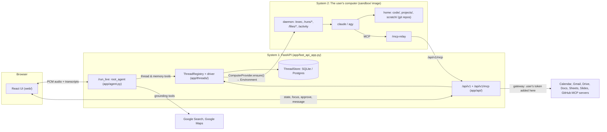
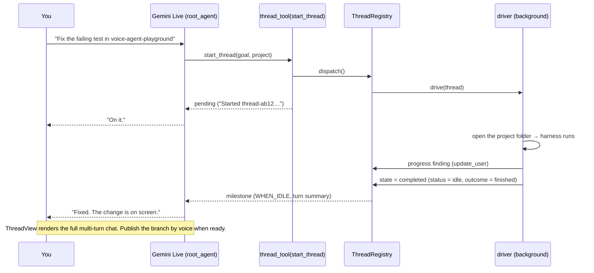
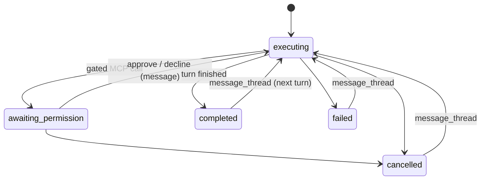
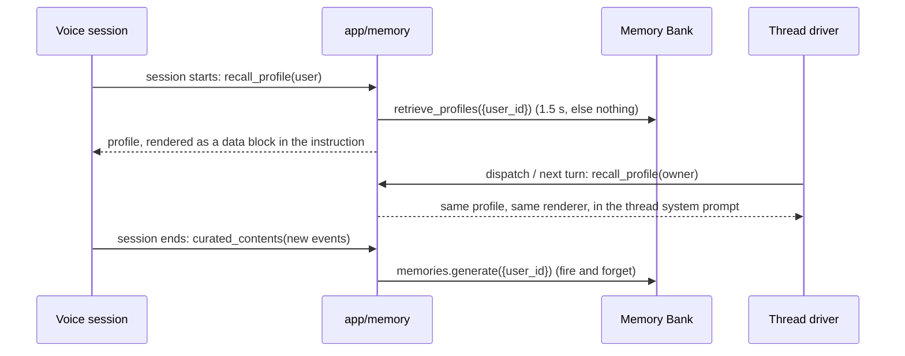

# Architecture

ADK Voice Agent splits fast voice interaction (**System 1**) from slow, stateful coding and connected-app work (**System 2**):

- **System 1** is one FastAPI process serving the Gemini Live voice agent over ADK's `/run_live` WebSocket, the REST control plane at `/api/v1`, and the built React UI at `/`.
- **System 2** runs on **the user's computer**: a personal Linux box with a persistent home directory where the `claude` and `agy` coding harnesses run, managed by a `ComputerProvider` (host directory, Docker, static URL, or GCE VM).

System 1 talks, stores the thread record, and holds every OAuth token; System 2 executes coding, research, and connected-app threads.

In this doc:

- [A voice turn](#a-voice-turn)
- [Thread lifecycle](#thread-lifecycle)
- [Sharing context between threads](#sharing-context-between-threads)
- [Continuity across connections](#continuity-across-connections)
- [Screen focus and projects](#screen-focus-and-projects)
- [Memory](#memory)
- [Where code runs](#where-code-runs)
- [The filesystem](#the-filesystem)
- [The MCP gateway](#the-mcp-gateway)
- [The visual stage](#the-visual-stage)
- [Connected apps and auth](#connected-apps-and-auth)
- [REST control plane](#rest-control-plane)



## A voice turn

Slow tools return a pending result immediately and deliver the final result with a `WHEN_IDLE` hint at the next pause.



- [`app/voice/non_blocking.py`](../app/voice/non_blocking.py) → `non_blocking_tool()` and `thread_tool()` wrap async tools as ADK streaming tools. A lookup still running after `STILL_WORKING_AFTER_S` (8 s) yields one `WHEN_IDLE` status line (`format_still_working()`).
- [`app/voice/thread_updates.py`](../app/voice/thread_updates.py) → `ThreadUpdates` announces each milestone (`PERMISSION_REQUESTED`, `COMPLETED`, `ERROR`, `CANCELLED`) once, fencing untrusted harness text in `<untrusted_thread_output>` tags. `COMPLETED` carries the generated turn summary (`summarize_turn()`), falling back to the start of `result_text`.
- [`app/voice/briefing.py`](../app/voice/briefing.py) summarizes milestones missed while away and adds `NOT CONNECTED` (`build_connections_briefing()`) for unconnected apps. Callbacks live in [`app/voice/callbacks.py`](../app/voice/callbacks.py).
- **Connecting just in time.** When a request needs an app in `NOT CONNECTED`, the voice says so in one line, calls `navigate` ([`navigation_tools.py`](../app/tools/navigation_tools.py)) to open Settings → Connect, and resumes when the UI sends `[APP CONNECTED] <name>`.

### Voice modes

Users choose a voice mode in Settings → Voice mode (default `VOICE_MODE`, else `native`), applied on their next conversation:

- **Native**: one Gemini Live model (`LIVE_MODEL`) with session resumption and context-window compression.
- **Cascaded**: ADK `CascadeLive` chains `CASCADE_STT_MODEL`, `CASCADE_LLM_MODEL` (`thinking_level=MINIMAL`), and `CASCADE_TTS_MODEL`.

[`app/voice/voice_mode.py`](../app/voice/voice_mode.py) → `VoiceSessionPlugin` pins the mode in session temp state and sets `RunConfig` via `live_run_config()`. `VoiceAgent.canonical_live_model_async()` selects the model or cascade, and tools/instructions read `is_cascaded()`. In cascaded mode, `non_blocking_tool()` and `thread_tool()` declare plain twins that return immediately and deliver updates as `[BACKGROUND THREAD UPDATE]` or `[TOOL RESULT]` turns (adding ~1.5–3 s to first audio and resending full history each turn).

## Thread lifecycle

Work runs in a multi-turn **Thread** (`thread-<16 hex>`) inside a project folder (`code/<repo>`, `projects/<slug>`, or `scratch/<date>-<slug>`). Each `start_thread` or `message_thread` appends a `Turn` (`seq`, `prompt`, `outcome`, `answer`, `error`, `cards`, `files_changed`, `diff_summary`, `raw_diff`, `artifacts`, `outputs`, `commit_sha`, `pushed`, `started_at`, `ended_at`) to `handle.turns` (`raw_diff` is retained only on the latest turn in memory and omitted from REST responses).

- **`status`:** `"running"` (`ThreadState.EXECUTING`), `"awaiting_approval"` (`ThreadState.AWAITING_PERMISSION`), or `"idle"` (`COMPLETED`, `FAILED`, `CANCELLED`). "Starting your computer…" is emitted as a `PROGRESS` event (`latest_update`).
- **`outcome`** (when idle): `"finished"`, `"failed"`, `"cancelled"`, or `""`.
- **Verbatim delegation.** [`app/threads/prompts.py`](../app/threads/prompts.py) passes the user's request verbatim on `START` and `FOLLOWUP` (plus an optional `[Workspace note]`). Clarifying questions and plans are written in the normal turn response (`completed`).
- **Progress findings.** Harnesses call `update_user` on the MCP bridge to report findings.
- **Approvals.** Calls matching `mcp_gates` in [`config/policy.yaml`](../config/policy.yaml) pause the thread in `awaiting_permission` (`status="awaiting_approval"`) and resume with `--resume` when approved. Voice consent is a two-turn prompt rule (graded by `gated_send` and `publish_consent`); the UI Allow button sends the request's `permission_key` and is the authoritative server gate.
- **Steer or follow up.** `message_thread` interrupts a running thread or starts turn N+1 on an idle thread (`harness=...` hands off with `handoff_summary()`). Code threads commit to `agent/<thread_id>` and push only on `publish_thread`.

[`app/threads/model.py`](../app/threads/model.py) defines `TRANSITIONS`; invalid edges raise `InvalidTransition`.



- [`app/threads/registry.py`](../app/threads/registry.py) → `ThreadRegistry` (`dispatch`, `approve`, `steer`, `share_context`, `cancel`, `publish`, `unseen_milestones`, `mark_seen`) scopes all operations to `acting_user_id()` ([`app/auth/identity.py`](../app/auth/identity.py)), raising `ThreadNotFound` (404) or `ThreadInputError` (both `ThreadError`).
- [`app/threads/driver.py`](../app/threads/driver.py) → `drive()` runs each segment inside `run_as(handle.owner)`.
- [`app/store/thread_store.py`](../app/store/thread_store.py) → `ThreadStore` persists threads and append-only events; interrupted threads are marked failed on startup and can be resumed with `message_thread`.
- [`app/threads/documents.py`](../app/threads/documents.py) backs `save_to_drive({path, title?})`, uploading deliverables to `ADK Voice Agent/<project title>` when **Settings → Save files to Drive** is on and Google is connected.
- [`app/threads/summaries.py`](../app/threads/summaries.py) → `summarize_turn()` uses a cached `genai.Client` per `(project, location)` and `GROUNDING_MODEL` to write a 1–3 sentence spoken summary stored on `Turn.summary`.
- [`app/context_cards.py`](../app/context_cards.py) → `card_items()` validates `present_card({kind, title, items})` onto `Turn.cards` (up to 3 per turn).
- [`app/api/mcp.py`](../app/api/mcp.py) serves ADK Voice Agent's own tools and the connected-app gateway at `/api/v1/mcp` (see [`connected-apps-mcp`](../sandbox/skills/connected-apps-mcp/SKILL.md)).

## Sharing context between threads

`share_context(from_thread_id, to_target, instruction)` on [`ThreadRegistry`](../app/threads/registry.py) ([`app/tools/thread_tools.py`](../app/tools/thread_tools.py)) formats a `<untrusted_thread_output>`-fenced `[SHARED CONTEXT from thread <id> (<title>) in <project>]` block via [`app/threads/prompts.py`](../app/threads/prompts.py) → `share_context_block(source)` and messages an existing thread or starts a new thread in `to_target` (defaulting to `source.project` when empty).

## Continuity across connections

[`app/voice/continuity.py`](../app/voice/continuity.py) maintains continuity across Live connections:

- Native sessions enable Live session resumption and context-window compression via [`voice_mode.py`](../app/voice/voice_mode.py) → `live_run_config()` (`VoiceSessionPlugin`).
- `hydrate_threads` reads the user's previous session if it ended within `VOICE_AGENT_CARRYOVER_MINUTES` (default 10; 0 disables), filters it with `ingest.curated_turns()`, and injects a `JUST BEFORE THIS CONVERSATION` block (1.5 s timeout, fail-open).

## Screen focus and projects

- **Screen focus (`OPEN ON SCREEN`).** [`app/voice/focus.py`](../app/voice/focus.py) stores `{view: "home" | "project" | "thread", project, thread_id}` per user, updated by `POST /api/v1/focus` and `navigate` ([`app/tools/navigation_tools.py`](../app/tools/navigation_tools.py)). When the user switches views during an open `/run_live` session, `POST /api/v1/focus` also pushes a live `[SCREEN FOCUS]` text turn so mid-session references resolve without waiting for a reconnect. `build_focus_section()` renders `OPEN ON SCREEN` into `build_orchestrator_instruction()`, and thread tools resolve `"current"` from `get_focus(user_id)`.
- **Projects and threads.** [`app/projects.py`](../app/projects.py) backs `GET /api/v1/projects`, `GET /api/v1/projects/{project}/thread`, and `YOUR WORK`. User labels (`ProjectLabels`: names, hidden projects, Drive keys) live in the app database; titles fall back to `default_name()`, and status lines read `AGENTS.md` (`## Status`) from a running computer (`factory.running_environment()`, 1.5 s timeout) or fall back to the newest thread in the store. `PATCH /api/v1/projects/{project}` and `name_project` rename or hide projects.
- **Retention.** `RETENTION_DAYS` (90, [`app/threads/retention.py`](../app/threads/retention.py)) expires finished threads, events, `DatabaseSessionService` voice sessions, and conversation memories after 90 days.

## Memory

ADK Voice Agent stores one structured profile per user in the Agent Engine [Memory Bank](https://docs.cloud.google.com/gemini-enterprise-agent-platform/scale/memory-bank/profiles) ([`terraform/memory.tf`](../terraform/memory.tf)), while ADK sessions live in `THREAD_DB_URL` (`DatabaseSessionService`). Without `GOOGLE_CLOUD_AGENT_ENGINE_ID`, memory is disabled.



- [`app/memory/profile.py`](../app/memory/profile.py) → `UserProfile` defines the schema, and `render_profile()` renders it as an angle-bracket-stripped `<user_profile>` data block.
- [`app/memory/store.py`](../app/memory/store.py) → `MemoryStore` / `MemoryBankStore` scopes every call to `{"user_id": ...}`. `recall_profile()` is called by [`briefing.py`](../app/voice/briefing.py) → `collect_profile()` and by the thread driver. `ensure_profile_schema()` registers the schema during `make onboard` / `make deploy`.
- [`app/memory/ingest.py`](../app/memory/ingest.py) → `remember_on_close()` filters events through `curated_contents()` (user speech, agent replies, and `start_thread`, `message_thread`, `share_context` arguments) and triggers background generation ([Security model: memory](security-model.md#memory)).
- **Settings → Memory** exposes `GET /memories` and `DELETE /memories/{id}`.

### Episodes: conversations and threads

[`app/memory/episodes.py`](../app/memory/episodes.py) records short factual memories in two separate scopes:

| Collection | Scope | One memory per | Points at | Lifetime |
|---|---|---|---|---|
| Conversations | `{user_id, kind: conversation}` | voice conversation | `session_id` | 90 days |
| Threads | `{user_id, kind: thread}` | thread, rewritten when each turn ends | `thread_id`, `origin_session_id` | as long as the thread |

- **Writing:** `remember_on_close()` writes a 2–4 sentence recap of `curated_turns()` using `MEMORY_MODEL` (via a cached `genai.Client` per `(project, location)`). When a turn ends, the registry rewrites the thread memory from user words and server facts (`thread_fact()`), never harness output.
- **Reading & deleting:** `hydrate_threads` loads `EARLIER CONVERSATIONS`, and [`app/tools/memory_tools.py`](../app/tools/memory_tools.py) provides `recall`, `recall_conversation`, `remember`, and `forget`. Deleting a thread or episode (`GET /memory-episodes`, `DELETE /memory-episodes/{kind}/{id}`) deletes its memory.

## Where code runs

Each user gets an isolated POSIX computer with a persistent home disk, while System 1 runs on Cloud Run.

**Capacity.** Terraform and `make deploy` pin Cloud Run to a single always-on instance (`min = max = 1`, `--concurrency=40`, `cpu_idle = false`, 3600 s timeout) because `ThreadRegistry`, `drive()` coroutines, and live session listeners are in-process. Redeploys mark in-flight threads interrupted so they can be resumed on the new instance.

- [`app/workers/environment.py`](../app/workers/environment.py) → `Environment` (`exec`, `list_files`, `read_file`, `write_file`, `activity`) is implemented by `SandboxEnvironment` (pooled `httpx.AsyncClient` against [`sandbox/server.py`](../sandbox/server.py)) and `LocalEnvironment`. [`app/workers/factory.py`](../app/workers/factory.py) → `resolve_environment()` and `set_environment()` resolve or override the acting user's environment.
- [`app/workers/providers/`](../app/workers/providers/) → `ComputerProvider` ([`base.py`](../app/workers/providers/base.py), selected via [`registry.py`](../app/workers/providers/registry.py)):

  | Provider | Where the computer runs | Home directory |
  |---|---|---|
  | `host` (default) | per-user directory on this machine (dev only) | `VOICE_AGENT_WORKSPACE_ROOT/u-<hash>` |
  | `docker` | local container per user | named Docker volume |
  | `static` | daemon at `COMPUTER_URL_TEMPLATE` | behind the URL |
  | `gce` | Compute Engine VM per user from instance template | persistent disk |

  Resources use `sandbox_owner()` (`u-<hash>`). [`reaper.py`](../app/workers/providers/reaper.py) runs `reap_once()`, `voice_session_opened()`, and `warm_once()`.
- [`app/workers/runs.py`](../app/workers/runs.py) launches and polls detached harness runs.
- [`app/workers/harnesses/`](../app/workers/harnesses/) defines `CodingHarness` (`base.py`), `CliHarness` (`ClaudeCodeHarness`, `AntigravityHarness`), and `CliHarness.thread_files()`. Image setup lives in [`sandbox/Dockerfile`](../sandbox/Dockerfile), [`sandbox/README.md`](../sandbox/README.md), [`sandbox/home/AGENTS.md`](../sandbox/home/AGENTS.md), and [`sandbox/skills/`](../sandbox/skills/).

## The filesystem

[`app/workers/workspace.py`](../app/workers/workspace.py) → `resolve_project()` maps each thread to a git repository under `/home/agent/`:

```text
/home/agent/                 # persistent user disk
├── AGENTS.md                # machine map and conventions
├── .agents/skills/          # linked into ~/.claude/skills and ~/.gemini/config/skills
├── inbox/                   # uploads
├── code/<repo>/             # main checkouts from workspaces manifest
├── projects/<slug>/         # durable projects
├── scratch/<date>-<slug>/   # one-off threads (pruned after 30 days)
└── .voice-agent/            # leases, run logs, per-thread harness files
```

- **Open (`open_workspace()`):** the first writer leases the folder (`~/.voice-agent/leases/`); code threads use branch `agent/<thread_id>`, others use `main`. Concurrent writers get a worktree at `<folder>/.worktrees/<thread_id>`.
- **Finish (`finish_workspace()`):** commits once per turn (`thread <id>: <title>`), computes changes from `git diff`, and merges worktrees back into `main` (emitting a `WARNING` event with the worktree path on conflict).
- **Clean up & promote:** `prune_scratch()` deletes scratch folders idle for 30 days; `name_project` calls `promote_scratch()` to move `scratch/<date>-<slug>` to `projects/<slug>` (`ProjectLabels.drive_key` preserves Drive links). `list_projects` in [`thread_tools.py`](../app/tools/thread_tools.py) lists `code/` and `projects/`.

## The MCP gateway

Harnesses connect to `voice_agent` at `/api/v1/mcp` ([`app/api/mcp.py`](../app/api/mcp.py)) using a per-thread token (`mint_mcp_token()`) relayed through `/mcp-relay` (`Environment.mcp_base_url`):

- **Built-in tools:** `list_threads`, `read_thread`, `update_user`, `save_to_drive`, `present_card`, `recall`, `recall_conversation`, `search_web_grounded`, `search_maps_grounded`.
- **Connected apps:** [`app/api/mcp_gateway.py`](../app/api/mcp_gateway.py) exposes tools from [`.mcp.json`](../.mcp.json) for connected apps ([`config/integrations.yaml`](../config/integrations.yaml)) as `<server>__<tool>`, and `call_gateway_tool()` attaches the user's token on the server.
- **Approvals:** calls matching `mcp_gates` in [`config/policy.yaml`](../config/policy.yaml) trigger [`mcp_permissions.py`](../app/api/mcp_permissions.py) → `request_permission()`, pausing the thread at `awaiting_permission` ([Security model: permission gates](security-model.md#permission-gates)).

## The visual stage

- [`app/api/surfaces.py`](../app/api/surfaces.py) → `build_a2ui_surfaces()` serves active [A2UI v0.9](https://github.com/google/A2UI) cards (`active_context_cards(user_id)`), rendered by [`A2UISurfaceDeck.tsx`](../web/src/components/a2ui/A2UISurfaceDeck.tsx).
- [`app/context_cards.py`](../app/context_cards.py) → `record_context_card()`, `CARD_KINDS`, and `card_items()` back both `look` ([`look_tools.py`](../app/tools/look_tools.py)) and `present_card` ([`app/api/mcp.py`](../app/api/mcp.py)), rendered by [`AnswerCard`](../web/src/components/a2ui/answer/AnswerCard.tsx) ([`web/src/lib/cards.ts`](../web/src/lib/cards.ts)).
- **Shared thread components** in [`web/src/components/stage/thread/`](../web/src/components/stage/thread/) (`ThreadReply`, `ThreadOutputs`, `ThreadMeta`) and `ThreadActions` in [`App.tsx`](../web/src/App.tsx) power [`HomeView.tsx`](../web/src/components/stage/HomeView.tsx), [`NavDrawer.tsx`](../web/src/components/stage/NavDrawer.tsx), and [`ThreadView.tsx`](../web/src/components/stage/ThreadView.tsx) (`ProjectFeed` and multi-turn thread chat).
- **Outputs:** [`app/api/mcp_outputs.py`](../app/api/mcp_outputs.py) → `gateway_output()` (`OUTPUT_TOOLS`) and `save_to_drive` record deliverable links on `Turn.outputs`, serialized as `links` by `output_links()` in [`app/api/serializers.py`](../app/api/serializers.py).
- **Focus sync:** view changes post to `POST /api/v1/focus` ([`web/src/lib/api.ts`](../web/src/lib/api.ts)) and follow `navigate` calls ([`web/src/lib/navigation.ts`](../web/src/lib/navigation.ts)).

## Connected apps and auth

- [`app/auth/identity.py`](../app/auth/identity.py) → `IdentityMiddleware` and `current_user_id()` enforce per-request identity (`dev` or `iap`).
- [`config/integrations.yaml`](../config/integrations.yaml), [`app/auth/providers.py`](../app/auth/providers.py) (`configured_apps()`, `app_for_server()`, `get_redirect_uri()`), [`provider_hooks.py`](../app/auth/provider_hooks.py) (`ProviderHooks`), and [`app/api/apps.py`](../app/api/apps.py) → `apps_state()` define connected apps.
- [`app/auth/credential_store.py`](../app/auth/credential_store.py) → `get_credential_store()` stores per-user tokens (`EnvCredentialStore` locally, `SecretManagerCredentialStore` deployed) warmed by `prefetch_user_credentials()`.
- [`app/user_settings.py`](../app/user_settings.py) → `load_user_settings()` / `save_user_settings()` ([`app/store/user_settings.py`](../app/store/user_settings.py)) and [`app/app_utils/user_context.py`](../app/app_utils/user_context.py) → `UserContextMiddleware` (`warm_user_context()`) load per-user settings and tokens.
- [`app/auth/oauth.py`](../app/auth/oauth.py) → `build_oauth_authorize_url()`, `exchange_oauth_code()`, and `ensure_fresh_access_token(provider)` handle OAuth 2.0 (+ PKCE) and refresh-token rotation.
- [`.mcp.json`](../.mcp.json) wires the [`workspace_mcp`](../workspace_mcp/) stdio servers and remote `github` server through [`mcp_gateway.py`](../app/api/mcp_gateway.py), [`policy.yaml`](../config/policy.yaml), and [`sandbox/skills/connected-apps-mcp/SKILL.md`](../sandbox/skills/connected-apps-mcp/SKILL.md).

## REST control plane

All routes under `/api/v1` ([`app/api/`](../app/api/)) sit behind [`IdentityMiddleware`](../app/auth/identity.py) ([Security model: identity](security-model.md#identity)).

| Method and path | Purpose |
|---|---|
| `GET /me` | Signed-in user `{user_id, auth_mode}` |
| `GET /state` | `{threads, a2ui_surfaces, computer}` (`ThreadSummary[]`, context cards, and last-known computer status from [`last_known.py`](../app/workers/providers/last_known.py)) |
| `POST /focus` | Update screen focus `{view, project?, thread_id?}` and notify open live sessions ([`app/voice/focus.py`](../app/voice/focus.py)) |
| `GET /config` | Account, harnesses, `apps` ([`apps.py`](../app/api/apps.py) → `app_info()`), preferences, and memory status |
| `GET /threads` | Paginated thread history (`?q=`, `?state=`, `?limit=`, `?before=`) |
| `POST /threads` | Start a thread `{goal, title?, project?, harness?}` (409 when at `MAX_RUNNING_THREADS_PER_USER`) |
| `DELETE /threads/{id}` | Stop and delete a thread |
| `GET /threads/{id}` | Full `ThreadDetail` (`turns`, `result_text`, `permission`, `links`, `events`; `raw_diff` omitted) |
| `POST /threads/{id}/approve` | Body `{permission_key}`: approve pending MCP permission request |
| `POST /threads/{id}/message` | Body `{instruction, harness?}`: decline permission, steer running thread, or start next turn |
| `POST /threads/{id}/cancel` | Stop a running or waiting thread |
| `GET /threads/{id}/events` | Append-only event log for a thread |
| `GET /projects` | User's projects ([Screen focus and projects](#screen-focus-and-projects)) |
| `PATCH /projects/{project}` | `{name?, hidden?}`: rename (promotes scratch to project) or hide |
| `DELETE /projects/{project}` | Delete all threads and history in `project` |
| `GET /projects/{project}/thread` | `{project, threads}` for `project` |
| `POST /harnesses/default` | Set default harness |
| `PATCH /preferences` | Update voice, timezone, or Drive preference |
| `POST /a2ui/dismiss` | Dismiss a context card |
| `POST /auth/{provider}/authorize` | Start OAuth / Grant access popup |
| `GET /auth/{provider}/callback` | Complete OAuth sign-in (`adk_oauth_complete`) |
| `POST /auth/{provider}/disconnect` | Revoke (best effort) and delete user's tokens for `provider` ([`verify.py`](../app/auth/verify.py)) |
| `GET /memories`, `DELETE /memories/{id}` | List or delete profile fields |
| `GET /memory-episodes`, `DELETE /memory-episodes/{kind}/{id}` | List or delete conversation and thread memories |

## Where things live

See [`AGENTS.md`](../AGENTS.md#layout).

## Where to go next

- [Security model](security-model.md): trust boundaries, computer credentials, and gates.
- [Your computer](computer.md): home folders and lifecycle.
- [Extending](extending.md): add a harness, app, or provider.
- [Evals](evals.md): System 1 and System 2 evaluations.
