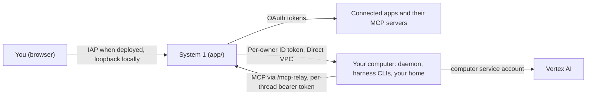

# Security model

ADK Voice Agent lets a voice agent start coding agents that run shell commands, commit code, and use connected apps. Read this page before deploying or pointing agents at real repositories.

In this doc:

- [Trust boundaries](#trust-boundaries)
- [What reaches the computer](#what-reaches-the-computer)
- [The MCP gateway](#the-mcp-gateway)
- [Permission gates](#permission-gates)
- [Identity](#identity)
- [Local and deployed modes](#local-and-deployed-modes)
- [Server hardening](#server-hardening)
- [Reporting a vulnerability](#reporting-a-vulnerability)

## Trust boundaries



| Boundary | What enforces it |
|---|---|
| Who can use the app | Locally: `127.0.0.1` loopback. Deployed: Cloud Run `--no-allow-unauthenticated` behind IAP ([`terraform/`](../terraform/README.md)). |
| Who a request runs as | [`IdentityMiddleware`](../app/auth/identity.py) ([below](#identity)) verifies the IAP JWT on every request when deployed, refuses `dev` mode in remote environments, and binds ADK session and `/run_live` routes to the signed-in user. |
| What a coding agent can touch | Its user's computer (`gce`: one VM and disk per user with no public IP; `docker`: one container and volume per user; `host`: local directory, development only). System 1's custom GCE VM role (`<service>_computer_vm_manager`) is conditioned on resource names prefixed `<service>-u-*`. |
| Who can reach a computer | `gce`: the daemon requires a Google ID token from `COMPUTER_ALLOWED_CALLERS` (`COMPUTER_REQUIRE_AUTH`) scoped to that VM's owner audience `<COMPUTER_AUTH_AUDIENCE>/<owner>` (`COMPUTER_OWNER` on the VM), and firewall rules allow only the app subnet and IAP ([`sandbox/README.md`](../sandbox/README.md#caller-auth)). Local `docker` computers use a dedicated bridge network (`enable_icc=false`) and bind to `127.0.0.1`. |
| Who can SSH into a computer | Only its owner: the `gce` provider grants IAP tunnel and OS Login on that user's instance plus `serviceAccountUser` on the computer service account. |
| What a coding agent may do without asking | Shell deny rules (cooperative guardrail) and server-enforced MCP gates ([below](#permission-gates)). |

## What reaches the computer

**Connected-app OAuth tokens never reach a computer.** Connected-app calls go through the [MCP gateway](#the-mcp-gateway), which attaches tokens on the server; server-driven `git` commands pass a short-lived GitHub token in that single `git` process environment with hooks and config overrides disabled.

| What | How it gets there | Lifetime | What it can do |
|---|---|---|---|
| Google Cloud identity | `gce`: VM metadata server (`computer_service_account_id`). `docker`: read-only ADC mount. `host`: local env minus [`server_only_env_keys()`](../app/auth/providers.py) | Managed by Google | `gce`: `roles/aiplatform.user`, `roles/logging.logWriter`, image pull, IAP invoke, and self-`signJwt` for `/mcp-relay`; cannot read secrets, disks, or Cloud SQL |
| Per-thread MCP bearer token | Minted per segment ([`mcp.py`](../app/api/mcp.py) → `mint_mcp_token()`) and passed in `VOICE_AGENT_MCP_TOKEN` | Revoked when segment ends (`revoke_mcp_token()`) | Calls `/api/v1/mcp` as the thread's owner behind `mcp_gates` |
| Computer IAP credential (`gce`) | Minted by `/mcp-relay` via `signJwt` | Cached until 5 min before expiry | Reaches System 1's `/api/v1/mcp` through IAP |
| GitHub token | Passed only to server-run `git` (`clone`, `fetch`, `switch`, `worktree add`, `push`) via `GIT_CONFIG_*` with `core.hooksPath=/dev/null`, `core.fsmonitor=false`, `http.sslVerify=true`, `http.proxy=`, `GIT_CONFIG_NOSYSTEM=1` ([`workspace.py`](../app/workers/workspace.py) → `git_env()`) | Single `git` process (up to 8 h App token) | Clone, fetch, and push `agent/<thread_id>` |

The daemon's `/mcp-relay` normalizes paths and forwards only `/api/v1/mcp`, and System 1 rejects the computer service account and `host.docker.internal` on non-MCP routes. `CliHarness.thread_files()` writes `${VOICE_AGENT_MCP_TOKEN}` placeholders, never raw tokens.

> [!WARNING]
> **Run logs hold the token during a run.** Although `revoke_mcp_token()` revokes each token when its segment ends, `~/.voice-agent/runs/<run>/stdout.jsonl` captures stdout while the run is active. Treat run logs as secret.

### Google Cloud identity

- **`gce`:** VMs run as `computer_service_account_id`; System 1's `adk-voice-agent` account never reaches a computer.
- **`docker` / `host`:** local development only (mounts local ADC or uses local gcloud env).
- Default `permissions.deny` rules block shell commands referencing `metadata.google.internal` or `169.254.169.254`; the computer service account's narrow IAM roles are the real boundary.

### GitHub

- **User-to-server GitHub App tokens only.** `make onboard` creates the GitHub App via [`github_app.py`](../scripts/provisioning/github_app.py) (Contents, Pull requests, and Issues R/W, Metadata read). Users tap **Connect** to install the App on selected repos and receive an 8-hour rotating user-to-server token ([`provider.py`](../app/auth/github/provider.py) → `GitHubHooks`). **Choose repos** updates the repo list without exchanging tokens. See [Connected apps: set up](connected-apps.md#set-up-once-in-make-onboard).
- **No personal tokens or App-wide installation tokens.** Unconnected users get `NOT_CONNECTED_NOTICE` ([`sandbox_token.py`](../app/auth/github/sandbox_token.py) → `sandbox_github_token()`).
- **Server-controlled git.** The server clones, fetches, and pushes `agent/<thread_id>` only on `publish_thread`; GitHub write tools pause at `mcp_gates`.

### Google in threads

Threads access `google_calendar__*`, `gmail__*`, `google_drive__*`, `google_docs__*`, `google_sheets__*`, and `google_slides__*` only when the owner has connected Google.

- **Reads and in-place Doc/Sheet edits** run with the server-held token (Docs and Sheets keep revision history, so in-place edits run ungated by design).
- **External or destructive actions pause at `mcp_gates`:** Gmail sends, Calendar event mutations, Drive deletes/sharing/metadata updates, and GitHub repo writes ([Permission gates](#permission-gates)). Approval cards and voice announcements show recipients and targets first (`to`, `cc`, `owner`, `repo`, `head`, `subject`) with a UI toggle to inspect the full `arguments` payload.
- **Saving to Drive (`save_to_drive`).** Enabled when **Settings → Save files to Drive** is on, uploading workspace files to `ADK Voice Agent/<project>` under `drive.file` scope ([`documents.py`](../app/threads/documents.py)).
- **Quick reads (`look`).** [`look_tools.py`](../app/tools/look_tools.py) executes only in-process `workspace_mcp` tools marked `readOnlyHint: true`.
- **Answer cards.** `present_card` strips items to `CARD_KINDS` allowlists ([`context_cards.py`](../app/context_cards.py)), capped at 20 items and 3 cards per turn.

> [!CAUTION]
> **Accepted risk: read and leak.** A thread with mail/Drive read access and internet egress can be tricked by prompt injection into exfiltrating read data. Replace Cloud NAT in [`network.tf`](../terraform/network.tf) with an egress proxy/NGFW and VPC Service Controls if required.

### Pinned tools

[`sandbox/Dockerfile`](../sandbox/Dockerfile) pins versions and SHA-256 checksums for Node, `uv`, `gh`, `claude`, and `agy`, building with zero credentials.

## The MCP gateway

- **Identity & server-held tokens.** Every `/api/v1/mcp` call authenticates via the per-thread token ([Architecture: the MCP gateway](architecture.md#the-mcp-gateway)). [`mcp_gateway.py`](../app/api/mcp_gateway.py) resolves the covering app via [`app_for_server()`](../app/auth/providers.py) ([`config/integrations.yaml`](../config/integrations.yaml), [`.mcp.json`](../.mcp.json)), fetches the token via `ProviderHooks.access_token()`, and attaches it on the server (`workspace_mcp/` stdio servers receive only `PATH`, `HOME`, `LANG`, `TMPDIR`, and the token).
- **Gates.** [`mcp_permissions.py`](../app/api/mcp_permissions.py) → `request_permission()` pauses calls matching `mcp_gates` until the user approves that exact tool and argument payload.

## Permission gates

[`config/policy.yaml`](../config/policy.yaml) ([`app/workers/policy.py`](../app/workers/policy.py) → `load_policy()`) configures:

| Key | Default | Enforced by |
|---|---|---|
| `permissions.deny` | metadata-server shell commands | [`claude.py`](../app/workers/harnesses/claude.py) → `permission_settings()` (`Bash(...)` globs) and [`antigravity.py`](../app/workers/harnesses/antigravity.py) → `deny_rules()` (`command(...)` prefixes; warns once on leading-`*` globs that only Claude Code can enforce) |
| `mcp_gates.ask` | `gmail.send*`, `google_calendar.{create,update,patch,delete,move,import,quickAdd}*`, `google_drive.{delete,trash,permissions,update_metadata}*`, `github.{merge,create_pull_request,update_pull_request,push_files,create_or_update_file,fork_repository,create_repository,create_branch,create_issue,update_issue,add_issue_comment,submit_pending_pull_request_review,delete}*` | The MCP gateway on the server ([above](#the-mcp-gateway)) |
| `run_budget` | 5 min silence / max runtime | The thread driver |

- **Web UI approval (authoritative gate):** `POST /api/v1/threads/{id}/approve` requires `{permission_key}` matching the active request (400 if missing, 409 on mismatch).
- **Two-turn voice consent (prompt rule):** The voice model describes the action first and calls `approve` only after the user confirms in the next turn (graded by `gated_send` and `publish_consent` in [Evals](evals.md)).

Users can append local rules in `~/.adk-voice-agent/policy.yaml`.

## Identity

[`IdentityMiddleware`](../app/auth/identity.py) resolves `current_user_id()` before any route:

| Mode | User id | Where |
|---|---|---|
| `dev` (default) | `VOICE_AGENT_DEV_USER_ID` (`local`) | Local only; refused with 500 in [remote mode](#local-and-deployed-modes) |
| `iap` | Lowercased `email` claim from verified `X-Goog-IAP-JWT-Assertion` (ES256, issuer `https://cloud.google.com/iap`, audience `VOICE_AGENT_IAP_AUDIENCE`) | Deployed (`make deploy`); only `/health` is exempt |

The middleware rejects (403 or WebSocket `1008`) any ADK session, `/run_live`, `/run`, `/run_sse`, or `/agent-identity/finalize` request whose `user_id` does not match the signed-in user.

### Threads and computers per user

- **Threads:** scoped to `acting_user_id()` in [`app/threads/registry.py`](../app/threads/registry.py); other users' IDs return 404. `MAX_RUNNING_THREADS_PER_USER` (default 3; 20 server-wide) caps concurrent runs.
- **Computers:** named `<service>-u-<hash>` via `sandbox_owner()` in [`app/workers/providers/common.py`](../app/workers/providers/common.py), with worktrees isolating concurrent threads ([Architecture: the filesystem](architecture.md#the-filesystem)).
- **Offboarding a user (revoking access and wiping resources):** removing a user from `iap_users` revokes web access, and removing their per-VM IAM bindings revokes `make ssh`:

  ```bash
  # Compute <owner> = u- + sha256(email)[:16] and <secret_hash> = sha256(email)[:32]
  gcloud compute instances remove-iam-policy-binding <service>-<owner> --zone=<zone> --member="user:<email>" --role="roles/compute.osLogin"
  gcloud compute instances remove-iam-policy-binding <service>-<owner> --zone=<zone> --member="user:<email>" --role="roles/iap.tunnelResourceAccessor"
  gcloud iam service-accounts remove-iam-policy-binding <service>-computer@<project>.iam.gserviceaccount.com --member="user:<email>" --role="roles/iam.serviceAccountUser"
  gcloud compute instances delete <service>-<owner> --zone=<zone> --quiet
  gcloud compute disks delete <service>-<owner>-home --zone=<zone> --quiet
  gcloud secrets delete <service>-user-<secret_hash> --quiet
  ```

### Settings per user

Voice preferences and default harness live in `user_settings` ([`app/user_settings.py`](../app/user_settings.py)).

> [!IMPORTANT]
> Deployments use Cloud SQL by default (`enable_cloud_sql`); if disabled, SQLite inside the single Cloud Run instance resets on restart or redeploy.

### Memory

Memory Bank profiles ([`app/memory/store.py`](../app/memory/store.py), [`app/memory/profile.py`](../app/memory/profile.py)) and episodes ([`app/memory/episodes.py`](../app/memory/episodes.py)) are scoped to `{"user_id": <id>}`:

- **Curated ingestion:** `curated_contents()` in [`app/memory/ingest.py`](../app/memory/ingest.py) passes only user speech, agent replies, and `start_thread`, `message_thread`, and `share_context` arguments—never tool or harness output (`test_only_speech_and_thread_requests_are_ever_remembered`).
- **Untrusted data blocks:** `render_profile()`, episode memories, `[BACKGROUND THREAD UPDATE]` notifications, and `share_context_block()` wrap content in delimited data blocks (`<user_profile>`, `<untrusted_thread_output>`) stripped of angle brackets so untrusted text cannot break out as instructions.

### Continuity and shared context

Carry-over ([`app/voice/continuity.py`](../app/voice/continuity.py)) and `share_context` ([`app/threads/registry.py`](../app/threads/registry.py), [`app/threads/prompts.py`](../app/threads/prompts.py) → `share_context_block()`) are strictly scoped to the acting user.

### Connected apps per user

Tokens live in [`app/auth/credential_store.py`](../app/auth/credential_store.py): `.env` locally, or `<service>-user-<first 32 hex of sha256(user id)>` in Secret Manager when deployed (`COMPUTER_DEPLOYMENT`, default `adk-voice-agent`), destroying superseded secret versions on write and caching for 30 s per instance. Disconnecting Google revokes OAuth grants (`GOOGLE_WORKSPACE_TOKEN_SOURCE=oauth`). See [GitHub](#github) and [The MCP gateway](#the-mcp-gateway).

### What each app asks for

Declared in [`config/integrations.yaml`](../config/integrations.yaml) (`AuthProvider` in [`providers.py`](../app/auth/providers.py)):

| App | Scopes / permissions |
|---|---|
| Google (`google_workspace`) | `userinfo.email`, `calendar.events`, `calendar.readonly`, `gmail.readonly`, `gmail.compose`, `gmail.send`, `drive.readonly`, `drive.file`, `documents`, `spreadsheets`, `presentations.readonly` (`GOOGLE_WORKSPACE_GRANTED_SCOPES` tracks granted scopes) |
| GitHub (`github`) | GitHub App user token (`APP_PERMISSIONS` in [`github_app.py`](../scripts/provisioning/github_app.py)): Contents, Pull requests, and Issues R/W, Metadata read |

### App registrations

OAuth client credentials come only from environment variables populated by `make onboard` / `make deploy` ([Connected apps: set up](connected-apps.md#set-up-once-in-make-onboard)); unconfigured apps are hidden ([`configured_apps()`](../app/auth/providers.py)).

## Local and deployed modes

Remote mode activates when `K_SERVICE` is set or `APP_URL` is non-loopback ([`app/auth/providers.py`](../app/auth/providers.py)):

| | Local (`make dev`) | Deployed (`make deploy`) |
|---|---|---|
| Reachable from | `127.0.0.1` (`HOST=0.0.0.0` for LAN) | IAP-authorized users |
| Identity | `local` (`VOICE_AGENT_AUTH_MODE=dev`) | IAP JWT email (`VOICE_AGENT_AUTH_MODE=iap`) |
| User tokens | `.env` | Per-user Secret Manager secret (`<service>-user-<hash>`) |
| OAuth client secrets | `.env` | Secret Manager env vars on `adk-voice-agent` SA |
| Thread & settings DB | Local SQLite | Cloud SQL Postgres (`enable_cloud_sql`) |

## Server hardening

- **CORS & DNS rebinding:** restricted to local dev origins or `APP_URL` (`ALLOW_ORIGINS`), with [`LocalHostGuard`](../app/app_utils/host_guard.py) checking `Host` headers on `0.0.0.0` (`VOICE_AGENT_ALLOWED_HOSTS`).
- **Credential & `.env` writes:** tokens are written only on verified OAuth callbacks ([`verify.py`](../app/auth/verify.py)), and `.env` values are escaped ([`app/auth/env_store.py`](../app/auth/env_store.py)).
- **OAuth:** single-use 10-minute state bound to the initiating user, PKCE for Google, origin-checked `postMessage`, and `APP_URL`-derived redirect URIs ([`app/auth/oauth.py`](../app/auth/oauth.py)).
- **Web UI:** served same-origin with path-traversal protection; ADK dev UI is disabled.

## Reporting a vulnerability

Report vulnerabilities through Google's [Vulnerability Reward Program](https://bughunters.google.com/).

## Where to go next

- [Architecture: the MCP gateway](architecture.md#the-mcp-gateway).
- [Connected apps](connected-apps.md).
- [Your computer](computer.md#decide-what-agents-may-do-without-asking).
- [Extending: change what needs approval](extending.md#change-what-needs-approval).
